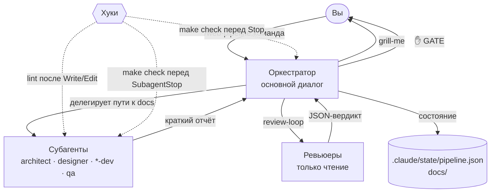

# Как устроен пайплайн

Каждая команда `web-pipeline` — это скилл-оркестратор. Он выполняется в основном диалоге, а работу раздаёт специализированным субагентам. Хуки следят за качеством независимо от того, что решит модель.

## Компоненты

| Компонент | Что это в Claude Code | Примеры |
|---|---|---|
| Скилл-оркестратор | Скилл с `disable-model-invocation: true`: вызывается только вами | `new-project`, `change`, `deploy`, `secure-maintain` |
| Процедурный скилл | Скилл, который оркестратор вызывает как шаг | `dev-core:grill-me`, `dev-core:review-loop`, `web-pipeline:init` |
| Навык-знание | Скилл со стандартами, предзагружается в агентов | `frontend-style`, `backend-standards`, `testing-standards`, `ansible-conventions`, `dev-core:reuse-first` |
| Субагент | Отдельный контекст со своей моделью, effort и инструментами | `architect`, `backend-dev`, `code-reviewer`… |
| Хук | Скрипт, который Claude Code запускает на событиях | lint после правки, `make check` перед остановкой, guard для Bash |
| Исполняемый файл в `bin/` | Попадает в PATH инструмента Bash | `git-snapshot` |
| MCP-сервер | Внешние инструменты | Context7, Playwright |

## Поток управления

### Оркестратор

Оркестратор работает на модели текущей сессии. Он:

- ведёт интервью с вами и показывает результаты в точках решения;
- раздаёт задачи субагентам. Каждое поручение самодостаточное: субагент не видит диалог, поэтому получает пути к `docs/spec.md`, `docs/architecture.md`, `docs/design.md`, `docs/plan.md`, критерии приёмки и описание ожидаемого отчёта;
- передаёт **пути, а не содержимое** файлов;
- после каждого шага обновляет `.claude/state/pipeline.json`;
- сам не пишет код приложения, кроме тривиальной склейки готовых частей.

### Субагенты

У каждого агента во frontmatter заданы модель и effort под его задачу ([сводная таблица](../web-pipeline/agents/index.md)):

- **Opus** принимает решения и делает ревью: architect, designer, все ревьюеры;
- **Sonnet** пишет код: backend-dev, frontend-dev, qa-engineer;
- **Haiku** разбирает объёмный вывод сканеров: ops-auditor.

Оркестратор не переопределяет модели, кроме одного шага эскалации: если реализация дважды не прошла `make check`, задача один раз передаётся Opus. Claude Fable автоматически не используется. Пайплайн предлагает его вам, только если проблема пережила эскалацию на Opus.

Ревьюеры и аудитор работают только на чтение: у них отключены `Write`, `Edit`, `NotebookEdit` и `Agent`.

### Хуки

Хуки срабатывают в любом проекте, поэтому каждый проверяет условие активации:

- хуки `web-pipeline` работают, только если в проекте есть `.claude/web-pipeline.json`. Исключение — guard для Bash: он только спрашивает или запрещает и работает везде;
- хук `dev-core` работает, только если есть `.claude/state/pipeline.json`, то есть пайплайн активен.

Подробно: [хуки web-pipeline](../web-pipeline/hooks.md), [context-guard](../dev-core/context-guard.md).

## Почему так

- **Контекст основного диалога — дефицитный ресурс.** Качество ответов падает по мере его заполнения. Поэтому весь объёмный вывод (исходники, логи, сканеры) остаётся в контексте субагентов, а в основной диалог попадают только их отчёты. Подробнее на странице [Контекст и /clear](context.md).
- **Независимое ревью.** Ревьюеры не видят, как писался код, и проверяют diff против спецификации и стандартов.
- **Детерминированные проверки.** Формат, линтер и `make check` запускают хуки, а не решение модели.
- **Ограниченные циклы.** Ревью и исправления ограничены числом раундов, поэтому пайплайн сходится.

## Общие и доменные плагины

`dev-core` содержит то, что не зависит от предметной области: интервью, цикл ревью, протокол переиспользования, снимки дерева, контроль контекста. Доменные плагины (сейчас это `web-pipeline`) объявляют `"dependencies": ["dev-core"]` и обращаются к общим скиллам по полному имени, например `dev-core:review-loop`. Скиллы между плагинами не копируются. Подробнее в разделе [Соглашения](../development/conventions.md).
