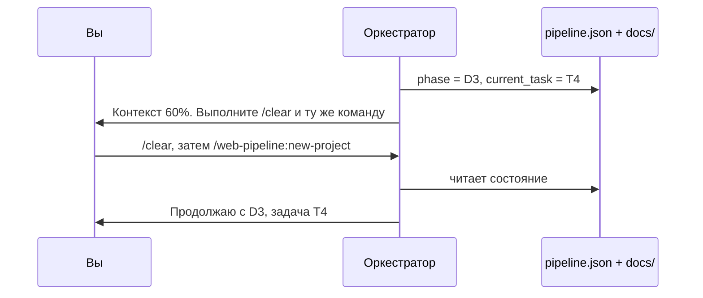

# Состояние и возобновление

Каждый оркестратор можно прервать в любой момент и продолжить в новой сессии. Для этого состояние хранится в файлах проекта, а не в контексте диалога.

## Файлы состояния

Все они лежат в `.claude/state/`. [`init`](../web-pipeline/commands/init.md) добавляет эту папку в `.gitignore`.

| Файл | Кто пишет | Содержимое |
|---|---|---|
| `pipeline.json` | Оркестраторы `new-project` и `change` | Текущий поток, фаза, задача, базовый снимок |
| `review-loop.json` | [`dev-core:review-loop`](../dev-core/skills/review-loop.md) | Номер раунда, лимит, снимки, открытые и отложенные находки |
| `gate-*.seen`, `gate-*.blocks`, `gate-pass.tree` | [Stop-хук](../web-pipeline/hooks.md#stop-gate) | Снимки дерева и счётчики неудачных проверок |

### pipeline.json

```json
{
  "flow": "new-project",
  "phase": "requirements",
  "current_task": "T4",
  "implementation_base": "<git tree hash>",
  "change_doc": "docs/changes/0003-export-csv.md"
}
```

| Поле | Значение |
|---|---|
| `flow` | `new-project` или `change` |
| `phase` | Фаза, с которой продолжать: `requirements`, архитектура, дизайн, `D1`…`D5` |
| `current_task` | Текущая задача из `docs/plan.md` во время D3 |
| `implementation_base` | Снимок [`git-snapshot`](../dev-core/git-snapshot.md) перед началом реализации. От него считается diff для ревью |
| `change_doc` | Только для `change`: путь к документу изменения |

Наличие `pipeline.json` — признак активного пайплайна. По нему срабатывает [context-guard](../dev-core/context-guard.md).

## Как работает возобновление

Каждый оркестратор начинается с раздела «Resume first»:

1. Если `.claude/state/pipeline.json` есть (для `change` — с `"flow": "change"`), оркестратор читает его.
2. Сообщает, на какой фазе остановился прошлый запуск.
3. Продолжает с неё, а не начинает заново.

Документы в `docs/` — вторая половина памяти: спецификация, архитектура, план с отметками выполненных задач, дизайн-система. Новая сессия читает их по путям и получает весь контекст решений.



## Сброс

Чтобы начать поток заново, удалите `.claude/state/pipeline.json` (и при необходимости `review-loop.json`). Документы в `docs/` при этом останутся, и новый запуск их учтёт.
