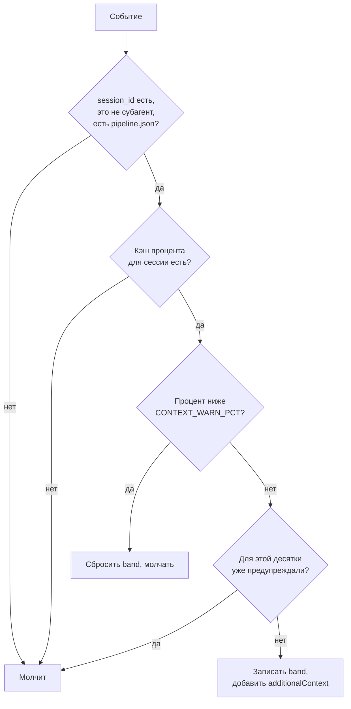

# Хук context-guard

Сообщает оркестратору, что контекст основного диалога заполнился выше порога, чтобы тот на ближайшей границе этапов предложил `/clear` и возобновление. Зачем это нужно, описано на странице [Контекст и /clear](../concepts/context.md).

| | |
|---|---|
| События | `UserPromptSubmit`; `PostToolUse` с matcher `Agent|Task` |
| Таймаут | 10 с |
| Активен | Только если есть `.claude/state/pipeline.json` и только в основном диалоге |
| Настройка | `CONTEXT_WARN_PCT` (по умолчанию `50`) |
| Исходник | `plugins/dev-core/scripts/context-guard.sh`, `plugins/dev-core/hooks/hooks.json` |

## Когда срабатывает

- Перед обработкой каждого вашего сообщения.
- После каждого вызова субагента (`Agent` или `Task`): долгие оркестрации могут не получать ваших сообщений часами.

## Алгоритм

Процент читается из `${XDG_CACHE_HOME:-~/.cache}/claude-context/<session_id>`. Этот файл пишет ваша [строка состояния](../concepts/context.md#строка-состояния). Отметка о последнем предупреждении хранится рядом в `<session_id>.band`.

## Что получает оркестратор

Хук возвращает `additionalContext` такого содержания:

> Context is at N% of the window, and answer quality degrades as it fills. At the next phase boundary or gate: bring `.claude/state/pipeline.json` and the docs up to date, then recommend that the user run `/clear` and re-run the pipeline command to resume from the state file. Until then, delegate anything bulky to subagents and avoid reading large files or long outputs in the main conversation.

Хук ничего не блокирует и не показывает вам сообщений напрямую. Решение о перезапуске оркестратор принимает в [чистой точке](../concepts/context.md#чистые-точки-перезапуска).

## Отключение

Хук молчит, если нет кэша строки состояния или нет активного пайплайна. Чтобы отключить его совсем, поднимите порог: `CONTEXT_WARN_PCT=101`.
