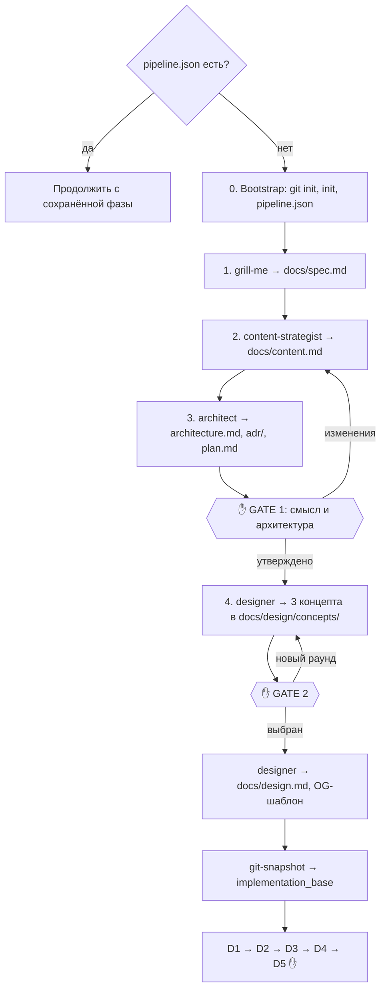

# new-project

Новый веб-проект от идеи до локальной проверки: интервью, смысл и тексты с SEO, архитектура, дизайн-концепты, реализация с контрактом в начале, проверки качества, ограниченное ревью.

| | |
|---|---|
| Вызов | `/web-pipeline:new-project [идея в нескольких словах]` |
| Автовызов | Нет (`disable-model-invocation: true`), только вручную |
| Точки решения | Подтверждение интервью, GATE 1 (смысл и архитектура), GATE 2 (дизайн), D5 (локальная проверка) |
| Состояние | `.claude/state/pipeline.json` с `"flow": "new-project"` |
| Исходник | `plugins/web-pipeline/skills/new-project/SKILL.md` |

Пошаговый пример есть на странице [Первый проект](../../getting-started/first-project.md).

## Этапы

### Resume first

Если `.claude/state/pipeline.json` существует, оркестратор говорит, на какой фазе остановился прошлый запуск, и продолжает с неё. Подробнее на странице [Состояние и возобновление](../../concepts/state.md).

### Фаза 0. Bootstrap

1. `git init` (ветка `main`), если папка ещё не репозиторий.
2. Скилл [`init`](init.md): `.claude/web-pipeline.json`, проверки anti-slop и SEO, папка состояния, раздел в `CLAUDE.md`. Стек на этом этапе неизвестен, поэтому записывается `TBD`.
3. `.claude/state/pipeline.json`: `{ "flow": "new-project", "phase": "requirements" }`.

### Фаза 1. Требования

[`dev-core:grill-me`](../../dev-core/skills/grill-me.md) по идее. Результат пишется в `docs/spec.md` по [шаблону spec.md](../templates.md#specmd).

Дерево решений обязательно покрывает:

- пользователей и задачу, ради которой они придут;
- **одну мысль, которую посетитель должен унести, и одно действие, которое он должен совершить**;
- доказательства, которыми вы можете это подкрепить;
- конкурентов или то, чем люди пользуются сейчас;
- должен ли сайт находиться в поиске или это закрытое приложение;
- user stories с **проверяемыми критериями приёмки**;
- что не входит в проект;
- данные и их чувствительность (персональные данные, платежи);
- интеграции, модель авторизации, ожидаемую нагрузку;
- языки и локали;
- хостинг (ваши серверы через Ansible) и бюджет на платные сервисы;
- визуальное настроение: ссылки на то, что нравится и не нравится, а не прилагательные.

### Фаза 2. Смысл и тексты

[`content-strategist`](../agents/content-strategist.md) получает путь к `docs/spec.md` и пишет `docs/content.md` по [шаблону content.md](../templates.md#contentmd):

- главная мысль, главное действие, доказательства и тон;
- карта страниц с URL и решением, индексировать ли каждую;
- по каждой странице: ключевое сообщение, секции по приоритету, вырезанное, выделение, готовые тексты;
- метаданные: title, description, canonical, Open Graph, JSON-LD;
- политика robots.txt и sitemap. По умолчанию пускаются все роботы, включая AI-ботов.

Отдельной точки решения здесь нет: смысл утверждается вместе с архитектурой на GATE 1.

### Фаза 3. Архитектура → GATE 1

[`architect`](../agents/architect.md) получает пути к `docs/spec.md` и `docs/content.md` и пишет `docs/architecture.md`, `docs/adr/NNNN-*.md` и `docs/plan.md`. Карта страниц из `content.md` для него — список публичных маршрутов. Отдельно он решает, как рендерятся публичные страницы, чтобы метаданные были в HTML от сервера.

Вам показывают две части:

- **Смысл:** главная мысль, главное действие, карта страниц, варианты заголовка главной с рекомендацией, политика robots, открытые вопросы по контенту.
- **Архитектура:** стек с причинами, способ отрисовки публичных страниц, таблица «готовое или своё», главные риски, число задач и отвергнутые варианты.

**GATE 1**: явное утверждение или изменения по обеим частям. Если меняется смысл или страницы, content-strategist перерабатывает `content.md`, а при изменении карты страниц architect обновляет план. После утверждения стек записывается в `.claude/web-pipeline.json` и `CLAUDE.md`, а `content.md` помечается утверждённым.

### Фаза 4. Дизайн-концепты → GATE 2

[`designer`](../agents/designer.md) получает пути к спецификации, `content.md` и архитектуре и делает 3 намеренно разных концепта в `docs/design/concepts/` (самостоятельные HTML). В концептах стоят тексты из `content.md` слово в слово, а главное действие — самый заметный элемент экрана. К каждому концепту прилагается описание: название, одна смелая идея, палитра, пара шрифтов, компромиссы.

**GATE 2**: вы открываете файлы в браузере и выбираете один, смешиваете («шрифты из A, сетка из C») или просите новый раунд. После выбора designer пишет `docs/design.md` (токены, шкала шрифтов, правила раскладки, движение, перечень компонентов) и шаблон OG-картинки `docs/design/og-template.html`.

### Фаза 5 и дальше. Реализация

Дерево фиксируется [`git-snapshot`](../../dev-core/git-snapshot.md), хэш сохраняется как `implementation_base`. Затем выполняются фазы [D1–D5](../delivery.md) из `shared/delivery-phases.md`. D5 — финальная точка решения.

## Кто задействован

| Этап | Агенты и скиллы |
|---|---|
| 0 | [`init`](init.md) |
| 1 | [`dev-core:grill-me`](../../dev-core/skills/grill-me.md) |
| 2 | [content-strategist](../agents/content-strategist.md) |
| 3 | [architect](../agents/architect.md) |
| 4 | [designer](../agents/designer.md) |
| D1–D3 | [backend-dev](../agents/backend-dev.md), [frontend-dev](../agents/frontend-dev.md), [qa-engineer](../agents/qa-engineer.md) |
| D4 | [`make seo`](../seo-check.md), затем [`dev-core:review-loop`](../../dev-core/skills/review-loop.md) с [code-reviewer](../agents/code-reviewer.md), [security-reviewer](../agents/security-reviewer.md), [design-critic](../agents/design-critic.md) |

## Какие файлы создаёт

`docs/spec.md`, `docs/content.md`, `docs/architecture.md`, `docs/adr/`, `docs/plan.md`, `docs/design/concepts/*.html`, `docs/design.md`, `docs/design/og-template.html`, `TODO.md`, код приложения, `Makefile`, тесты, а также всё, что создаёт [`init`](init.md). Полный список на странице [Файлы в проекте](../project-files.md).

## Язык

Оркестратор общается с вами на вашем языке. Документы в `docs/` тоже пишутся на вашем языке, если вы не попросите иначе.

## Типичные проблемы

- **Хочу начать заново, а он продолжает старый запуск.** Удалите `.claude/state/pipeline.json`.
- **Не нравится главная мысль или заголовки.** Скажите об этом на GATE 1, до дизайна: переписать текст дешевле, чем перерисовать концепты.
- **Концепты получились похожими.** Попросите новый раунд на GATE 2 и прямо назовите, что не понравилось. Designer обязан делать концепты намеренно разными.
- **`make check` красный из-за отсутствующего инструмента.** Установите его по подсказке из вывода ([Зависимости](../../getting-started/requirements.md)).
