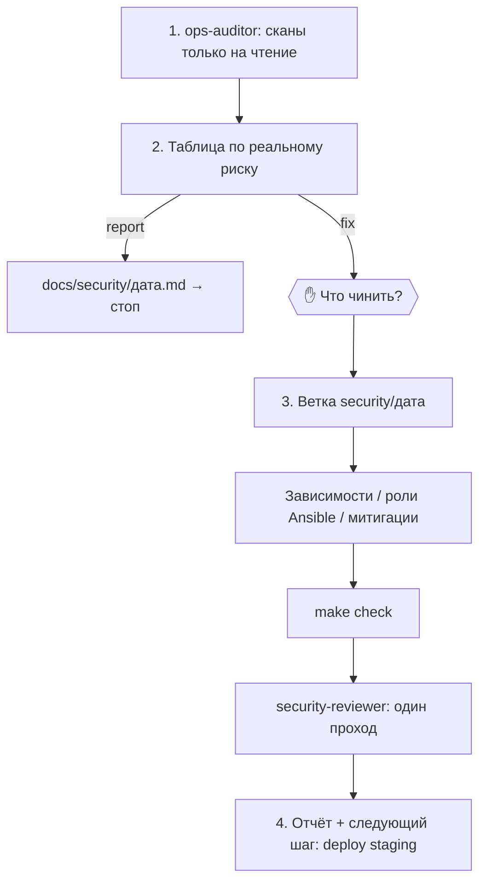

# secure-maintain

Обслуживание безопасности развёрнутого проекта: сканирование зависимостей, работающих образов и хостов на известные уязвимости, разбор находок с вами, исправления в ветке, проверка и передача в деплой. Есть режим только отчёта для запусков по расписанию.

| | |
|---|---|
| Вызов | `/web-pipeline:secure-maintain [report|fix] [staging|production|all]` |
| По умолчанию | `report`, `production` |
| Автовызов | Нет (`disable-model-invocation: true`), только вручную |
| Точка решения | Triage: что чинить (в режиме `fix`) |
| Ветка | `security/<YYYY-MM-DD>` (только `fix`) |
| Отчёт | `docs/security/<YYYY-MM-DD>.md` |
| Исходник | `plugins/web-pipeline/skills/secure-maintain/SKILL.md` |

## Режимы

| Режим | Что делает |
|---|---|
| `report` | Сканирует, пишет отчёт и останавливается. Ничего не меняет. Подходит для расписания |
| `fix` | После triage исправляет выбранные вами пункты в ветке, делает одно ревью безопасности и передаёт в деплой |

## Этапы



### 1. Сканирование

Делегируется [`ops-auditor`](../agents/ops-auditor.md) самодостаточным сообщением: путь к проекту, окружение, путь к inventory и список сканов. Аудитор выполняет только команды на чтение и возвращает одну нормализованную таблицу. Сырой вывод сканеров остаётся вне основного контекста.

| Что | Как |
|---|---|
| Зависимости кода | `osv-scanner scan source -r .`, `trivy fs --scanners vuln,secret,misconfig .`, `npm audit --omit=dev` или `pip-audit` |
| Что реально работает | SHA развёрнутого релиза (`readlink /srv/<app>/current` или теги образов) против `main`, затем `trivy image` на развёрнутых образах |
| Хосты | `ansible -i inventories/<env> all -b -m shell -a '…'` с командами только на чтение: ожидающие обновления безопасности, `lynis audit system --quick --no-colors`, нужна ли перезагрузка, открытые порты (`ss -tlnp`), срок TLS-сертификата, настройки sshd и ufw против роли `base` |
| Сам Ansible | `ansible-lint`, закреплённые версии коллекций в `requirements.yml` |

### 2. Triage → GATE

Одна таблица, отсортированная по реальному риску:

| ID | Где | Пакет / настройка | Severity (CVSS) | Эксплуатируемо здесь? | Версия с исправлением / действие | Трудоёмкость |
|---|---|---|---|---|---|---|

«Эксплуатируемо здесь» оценивается честно: уязвимый путь, который приложение никогда не вызывает, или dev-зависимость весят меньше. Находки, по которым аудитор написал `unknown`, разбирает оркестратор, работающий на более сильной модели.

В режиме `report` пишется отчёт, и работа заканчивается. В режиме `fix` вас спрашивают, какие пункты чинить сейчас.

### 3. Исправления (только `fix`, только утверждённое)

- Ветка `security/<YYYY-MM-DD>`.
- **Зависимости:** минимальное повышение версии, которое закрывает уязвимость: сначала patch, затем minor. Major — отдельный пункт, который сначала обсуждается с вами. Lock-файлы обновляются, changelog читается на предмет несовместимых изменений.
- **Проблемы хостов:** правятся **роли** Ansible (роль `base` для харденинга и обновлений). Серверы вручную не чинятся.
- **Исправления нет:** предлагается митигация (конфигурация, правило WAF, отключение функции) или замена библиотеки, принятый риск записывается.
- `make check`, затем один проход [`security-reviewer`](../agents/security-reviewer.md) по diff. Это одно ревью, а не цикл.
- На серверы ничего не применяется.

### 4. Передача

`docs/security/<YYYY-MM-DD>.md`: находки, что исправлено, что отложено и почему, принятые риски. Следующие шаги для вас: `/web-pipeline:deploy staging`, проверка, затем `/web-pipeline:deploy production`. **Из этой команды деплой в production никогда не запускается.**

## Запуск по расписанию

Для регулярного отчёта используйте скилл `schedule` или cron в папке проекта:

```cron
0 7 * * 1  cd /path/to/project && claude -p "/web-pipeline:secure-maintain report production"
```

По расписанию допускается только режим `report`. Рутинные patch-обновления дешевле делать через Renovate или Dependabot. Эта команда закрывает то, чего они не умеют: разбор в контексте проекта, major-версии, CVE без исправления и конфигурацию хостов.

## Кто задействован

[ops-auditor](../agents/ops-auditor.md) (сканы), [security-reviewer](../agents/security-reviewer.md) (ревью исправлений), [`ansible-conventions`](../skills/ansible-conventions.md) (правила работы с хостами).
