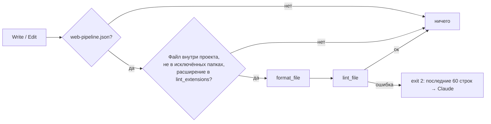
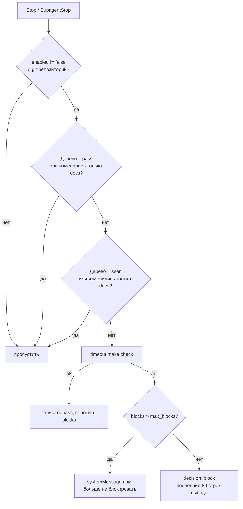

# Хуки

Хуки web-pipeline — детерминированная часть пайплайна. Они запускаются на событиях Claude Code независимо от решений модели.

Хуки плагина срабатывают во всех проектах, поэтому все они, кроме guard для Bash, ничего не делают, пока в проекте нет `.claude/web-pipeline.json` (его создаёт [`init`](commands/init.md)).

| Событие | Matcher | Скрипт | Таймаут | Нужен `web-pipeline.json` |
|---|---|---|---|---|
| `SessionStart` | `startup|clear` | `stop-gate.sh --baseline` | 30 с | да |
| `PreToolUse` | `Bash` | `guard-bash.sh` | 10 с | **нет** |
| `PostToolUse` | `Write|Edit|MultiEdit` | `post-edit.sh` | 120 с | да |
| `Stop` | — | `stop-gate.sh` | 600 с | да |
| `SubagentStop` | — | `stop-gate.sh` | 600 с | да |

Исходники: `plugins/web-pipeline/hooks/hooks.json` и `plugins/web-pipeline/scripts/`. Общие функции (`read_hook_input`, `opted_in`, `config_get`, `run_template`) лежат в `scripts/lib.sh`.

## post-edit

Форматирует и проверяет линтером каждый файл, который Claude записал или отредактировал. Ошибки линтера сразу уходят Claude (exit 2 и stderr), и он исправляет их на месте. Сама правка никогда не блокируется.

- Пропускаются файлы вне проекта и в `node_modules/`, `.git/`, `dist/`, `build/`, `.claude/`, `.venv/`.
- Команды берутся из `commands.format_file` и `commands.lint_file` с подстановкой `{file}` (путь экранируется). Каждая команда выполняется из корня проекта с таймаутом 60 с.
- Если команда пустая, шаг пропускается.

## stop-gate

Запускает проверку проекта (`commands.check`, по умолчанию `make check`) перед тем, как Claude или агент-исполнитель закончит работу. Если проверка красная, хук блокирует остановку и отдаёт Claude вывод ошибок.

Хук устроен так, чтобы не зацикливаться и не надоедать:

- запускается только если код изменился с последней успешной проверки или последнего запуска хука;
- изменения только в документах (`docs/`, `*.md`, `.claude/`) проверку не запускают;
- после `stop_gate.max_blocks` неудач подряд (по умолчанию 3) хук перестаёт блокировать и сообщает вам: «… still fails after 3 fix attempts; the gate stopped blocking. Review the failures yourself.»;
- выключен, пока `stop_gate.enabled` равен `false`. Включает его фаза [D1](delivery.md#d1-каркас-и-проверка-качества), когда `make check` впервые проходит.

### Для кого

| Событие | Кого проверяет | Ключ состояния |
|---|---|---|
| `Stop` | Основной диалог | `main` |
| `SubagentStop` | Только `backend-dev`, `frontend-dev`, `qa-engineer` | `agent-<имя>` |

Ревьюеры, architect и designer код не меняют, поэтому для них проверка не запускается.

### Как определяются изменения

Хук делает снимок рабочей копии через временный индекс (как [`git-snapshot`](../dev-core/git-snapshot.md), но без `.claude/state`) и сравнивает его с сохранёнными в `.claude/state/`:

| Файл | Значение |
|---|---|
| `gate-pass.tree` | Дерево последней успешной проверки (общее для всех ключей) |
| `gate-<key>.seen` | Дерево последнего запуска хука для этого ключа |
| `gate-<key>.blocks` | Число неудач подряд |

`SessionStart` с режимом `--baseline` при запуске сессии и после `/clear` записывает текущее дерево в `gate-main.seen`. Поэтому изменения, которые уже были до начала сессии, сами по себе не запускают проверку.

Сообщение при блокировке требует исправить ошибки и запрещает отключать проверки или помечать тесты пропущенными ради зелёного статуса.

## guard-bash

Требует вашего явного согласия на команды, которые меняют серверы или историю. Работает **во всех проектах**, потому что только спрашивает или запрещает и сам ничего не запускает.

| Команда | Решение |
|---|---|
| `rm -r…` по `/`, `~` или `$HOME` (включая `/*`) | **deny**: рекурсивное удаление корня или домашней папки запрещено всегда |
| `ansible-playbook` без `--check`, `-C`, `--syntax-check`, `--list-hosts`, `--list-tasks` | **ask**: «ansible-playbook without --check changes real servers…» |
| `git push` с `--force`, `--force-with-lease` или `-f` | **ask**: «Force push rewrites remote history.» |

Остальные команды проходят как обычно, по вашим настройкам разрешений.

## Отключение

- Все хуки, кроме guard, в одном проекте: удалите `.claude/web-pipeline.json`.
- Только stop-gate: `"stop_gate": { "enabled": false }` ([Конфигурация](configuration.md)).
- Только post-edit: очистите `format_file` и `lint_file` или `lint_extensions`.
- Плагин целиком: `claude plugin disable web-pipeline@nikiquark-ai-plugins`.
