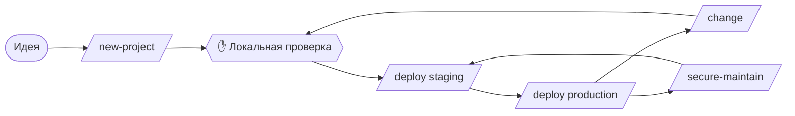

# web-pipeline

Веб-проекты от идеи до продакшена: спецификация, смысл и тексты с SEO, архитектура, смелые дизайн-концепты, бэкенд и фронтенд, проверки качества, ревью, деплой через Ansible и обслуживание безопасности.

```bash
claude plugin install web-pipeline@nikiquark-ai-plugins   # dev-core ставится как зависимость
```

## Жизненный цикл проекта



## Команды

| Команда | Что делает |
|---|---|
| [`/web-pipeline:new-project <идея>`](commands/new-project.md) | grill-me → `spec.md` → `content.md` (смысл, тексты, SEO) → архитектура ✋ → три дизайн-концепта ✋ → API-контракт → бэкенд, фронтенд и e2e → `make check` → `make seo` → ревью, не больше двух раундов → локальная проверка ✋ |
| [`/web-pipeline:change <что изменить>`](commands/change.md) | аудит кода → grill-me по изменению → `content.md`, если меняются публичные страницы → анализ влияния и план ✋ → дизайн, если меняется UI ✋ → реализация, проверки и ревью → локальная проверка ✋ |
| [`/web-pipeline:deploy [staging|production]`](commands/deploy.md) | preflight → `ansible-playbook --check --diff` ✋ → применение → smoke-тесты и индексация → заголовки, TLS, порты, trivy, ZAP baseline → отчёт, предложение отката |
| [`/web-pipeline:secure-maintain [report|fix] [env]`](commands/secure-maintain.md) | osv-scanner, trivy, lynis и обновления на хостах → разбор находок ✋ → ветка с исправлениями → отчёт |
| [`/web-pipeline:init [--legacy]`](commands/init.md) | Подключает проект к пайплайну. Вызывается из `new-project` и `change` |

✋ означает, что пайплайн ждёт вашего решения ([все точки решения](../concepts/gates.md)). Деплой на серверы запускаете только вы.

## Состав плагина

| Каталог | Содержимое | Документация |
|---|---|---|
| `skills/` (команды) | `new-project`, `change`, `deploy`, `secure-maintain`, `init` | [Команды](commands/new-project.md) |
| `shared/delivery-phases.md` | Общие фазы D1–D5 для `new-project` и `change` | [Фазы реализации](delivery.md) |
| `agents/` | 10 субагентов | [Субагенты](agents/index.md) |
| `skills/` (знания) | `frontend-style`, `seo-standards`, `backend-standards`, `testing-standards`, `ansible-conventions` | [Навыки-знания](skills/frontend-style.md) |
| `hooks/`, `scripts/` | Форматирование и линтер после правки, `make check` перед остановкой, guard для Bash | [Хуки](hooks.md) |
| `templates/` | `spec.md`, `content.md`, `change.md`, `web-pipeline.json`, раздел `CLAUDE.md`, `anti_slop.py`, `seo_check.py` | [Шаблоны](templates.md), [anti_slop.py](anti-slop.md), [seo_check.py](seo-check.md) |
| `.mcp.json` | Playwright MCP | [MCP Playwright](playwright.md) |

## Подключение проекта

Хуки плагина ничего не делают в проекте, пока в нём нет `.claude/web-pipeline.json`. Этот файл создаёт [`init`](commands/init.md). `new-project` и `change` вызывают его сами, поэтому отдельно запускать `init` обычно не нужно.

Настройки файла описаны на странице [Конфигурация](configuration.md), а всё, что пайплайн создаёт в проекте, — на странице [Файлы в проекте](project-files.md).

## Модели

| Агент | Модель | Effort |
|---|---|---|
| [content-strategist](agents/content-strategist.md) | Opus | high |
| [architect](agents/architect.md) | Opus | high |
| [designer](agents/designer.md) | Opus | high |
| [backend-dev](agents/backend-dev.md) | Sonnet | medium |
| [frontend-dev](agents/frontend-dev.md) | Sonnet | high |
| [qa-engineer](agents/qa-engineer.md) | Sonnet | medium |
| [code-reviewer](agents/code-reviewer.md) | Opus | high |
| [security-reviewer](agents/security-reviewer.md) | Opus | high |
| [design-critic](agents/design-critic.md) | Opus | medium |
| [ops-auditor](agents/ops-auditor.md) | Haiku | medium |

Оркестратор работает на модели текущей сессии. Переменные `CLAUDE_CODE_SUBAGENT_MODEL` и `CLAUDE_CODE_SUBAGENT_MODEL_FORCE=1` переводят всех субагентов на одну модель ([Переменные окружения](../reference/environment.md)).
