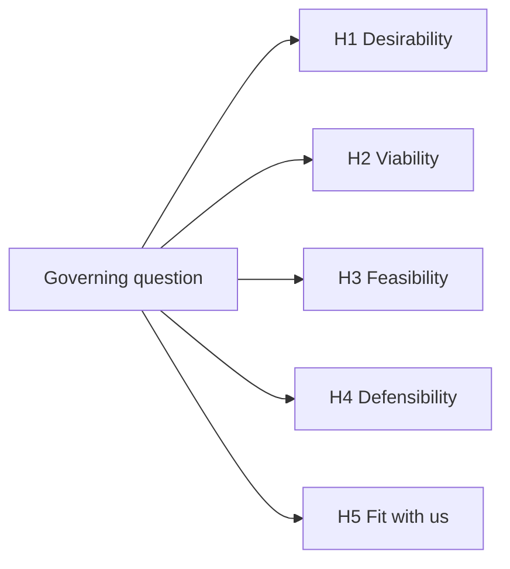

# <Idea name>: Issue tree

_Status: draft | approved · Date: YYYY-MM-DD_

**Governing question**: Is <idea> a good business for us to build, in <geography>, for <segment>?

**Hypothesis**: <the answer we expect, in one sentence>.

## Tree

## Leaves

Importance: how much the decision depends on it (high, medium, low). Evidence: how much we already know (none, weak, strong). Priority goes to high importance with weak or no evidence.

| Id | Hypothesis | Confirmed if | Refuted if | Importance | Evidence | Owner | Status |
|---|---|---|---|---|---|---|---|
| H1.1 | … | … | … | high | none | customer-researcher | open |

Status: open · supported (desk) · validated (customer evidence) · refuted. Owners: market-analyst, competitor-analyst, customer-researcher, strategist, experiment.

## Research depth
light | standard | deep, and why.
