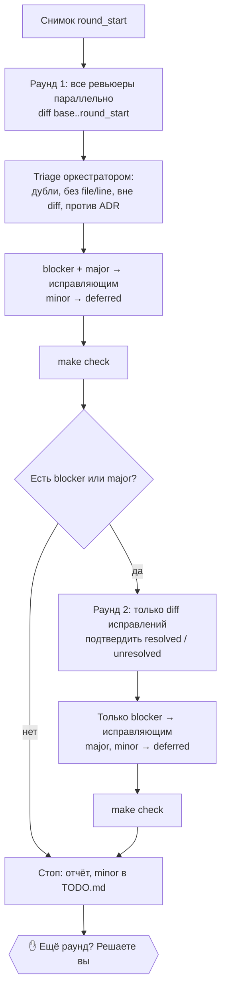

Ревью независимыми субагентами с исправлением найденного и **жёстким лимитом раундов** (по умолчанию 2). Лимит — это смысл скилла: цикл, который всегда может найти ещё одну мелочь, никогда не сходится. Поэтому момент остановки определяет процедура, а не ревьюеры.

| | |
|---|---|
| Вызов | `/dev-core:review-loop [max-rounds]` |
| Автовызов | Да, когда оркестратор или вы хотите ревью кода субагентами с исправлениями |
| Кто использует | Фаза [D4](../../web-pipeline/delivery.md#d4-ограниченное-ревью) web-pipeline, фаза 7 [`new-idea`](../../idea-pipeline/commands/new-idea.md#фаза-7-ревью) |
| Состояние | `.claude/state/review-loop.json` |
| Исходник | `plugins/dev-core/skills/review-loop/SKILL.md` |

## Когда срабатывает

> Bounded multi-reviewer review-and-fix loop with a hard round cap (default 2), structured verdicts and diff-only re-review. Use when an orchestrator or the user wants code reviewed by independent subagents and the findings fixed without endless iteration.

## Входные данные

Их передаёт вызывающий:

| Вход | Пример |
|---|---|
| Ревьюеры | `web-pipeline:code-reviewer`, `web-pipeline:security-reviewer` |
| Исправляющие | бэкенд-файлы → `web-pipeline:backend-dev` |
| База | Снимок или git-ref начала работы |
| Документы | Пути к спецификации, архитектуре, дизайну |
| Команда проверки | Обычно `make check` |
| Максимум раундов | Аргумент скилла, иначе **2** |

## Процесс



### Раунд 1: полное ревью изменения

1. Снимок дерева сохраняется как `round_start`. Объём ревью: `git diff <base> <round_start>`.
2. Все ревьюеры запускаются **параллельно, одним сообщением**. Каждое поручение самодостаточное: в нём команда diff, документы и формат вердикта.
3. **Triage до исправлений.** Оркестратор объединяет дубли и отбрасывает находки без конкретных файла и строки, находки вне diff (если diff их не вызвал) и находки, противоречащие утверждённому решению в спецификации или ADR. Каждая отброшенная находка записывается с причиной.
4. **blocker** и **major** уходят исправляющим, сгруппированные по областям. Затем запускается проверка. **minor** уходят в `deferred`.
5. `round = 2`.

### Раунд 2: ревью только исправлений

1. Новый снимок. Объём ревью: **только** `git diff <round_start> <новый снимок>`.
2. Ревьюеры получают diff исправлений и список находок первого раунда. Каждую они подтверждают как решённую или нет. Новые находки допускаются только для проблем, которые внесли сами исправления.
3. Исправляются **только blocker**. Остальное уходит в `deferred`. Затем запускается проверка.
4. `round = 3`.

### Остановка

- После второго раунда, или раньше, если в раунде нет blocker и major.
- **Третий раунд сам не запускается.** Вам показывают нерешённые blocker и отложенные major. Если вы явно попросите ещё раунд, `max_rounds` увеличивается на 1, и проходит ещё один раунд в стиле второго.
- Отложенные minor дописываются в `TODO.md` под заголовком с датой.
- Итоговый отчёт: находки по ревьюерам, сколько исправлено, отложено и отброшено, статус проверки.

### Эскалация

- Если исправление blocker дважды не проходит проверку, оно один раз передаётся тому же исправляющему с `model: "opus"`.
- Если один и тот же blocker пережил оба раунда, третий подход молча не пробуется: вам описывают обе попытки и спрашивают, как быть.

## Формат вердикта

Каждый ревьюер заканчивает ответ ровно одним блоком `json`:

```json
{
  "reviewer": "code-reviewer",
  "findings": [
    {
      "id": "CR-1",
      "severity": "blocker | major | minor",
      "file": "src/app/orders.ts",
      "line": 42,
      "problem": "что не так, конкретно",
      "evidence": "код или сценарий сбоя",
      "fix": "минимальное изменение, которое это решает"
    }
  ]
}
```

| Severity | Значение |
|---|---|
| **blocker** | Неверное поведение, потеря данных, дыра в безопасности, нарушенный критерий приёмки, падающая проверка |
| **major** | Явное нарушение стандартов проекта, которое дорого обойдётся позже: дублирование существующего кода, нет теста на основной путь, самописная версия того, что уже даёт зависимость |
| **minor** | Стиль, имена, желательные рефакторинги |

Префиксы id: `CR-` ([code-reviewer](../../web-pipeline/agents/code-reviewer.md)), `SEC-` ([security-reviewer](../../web-pipeline/agents/security-reviewer.md)), `DES-` ([design-critic](../../web-pipeline/agents/design-critic.md)), `FC-` ([fact-checker](../../idea-pipeline/agents/fact-checker.md)), `RT-` ([red-team](../../idea-pipeline/agents/red-team.md)).

## Состояние

```json
{ "round": 1, "max_rounds": 2, "base": "<tree>", "round_start": "<tree>", "open": [], "deferred": [] }
```

Файл переживает сжатие контекста и перезапуск сессии. Если в нём `round > max_rounds`, повторного ревью не будет: скилл сообщает открытые находки и останавливается.

Снимки делаются через [`git-snapshot`](../git-snapshot.md).
