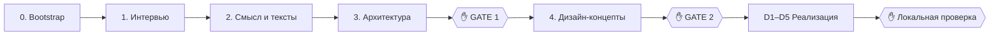

Пошаговый проход [`/web-pipeline:new-project`](../web-pipeline/commands/new-project.md) на учебной идее «сервис коротких ссылок». Вопросы и ответы ниже — пример. В реальном запуске они зависят от идеи и ваших ответов.

:::tip[Перед началом]
Поставьте плагины ([Установка](installation.md)) и обязательные инструменты: `git`, `jq`, `python3`, `make` ([Зависимости](requirements.md)). Для контроля контекста настройте [строку состояния](../concepts/context.md#строка-состояния).
:::

## Запуск

Создайте пустую папку, откройте в ней Claude Code и выполните:

```text
/web-pipeline:new-project сервис коротких ссылок со статистикой переходов
```



## Шаг 0. Bootstrap

Ничего отвечать не нужно. Пайплайн:

- выполняет `git init`, если папка ещё не репозиторий;
- вызывает [`init`](../web-pipeline/commands/init.md): создаёт `.claude/web-pipeline.json`, `scripts/anti_slop.py`, `scripts/seo_check.py`, `Makefile` с заглушками, `.claude/state/` и раздел в `CLAUDE.md`;
- записывает `.claude/state/pipeline.json` с `"phase": "requirements"`.

Стек пока неизвестен, поэтому в конфигурации записано `"stack": "TBD"`.

## Шаг 1. Интервью

Запускается [`grill-me`](../dev-core/skills/grill-me.md). Вопросы приходят раундами, к каждому дан рекомендуемый ответ:

```text
❓ Q1 - Кто пользователи: только вы, команда или публичный сервис с регистрацией?
➡️ Публичный сервис, но создавать ссылки могут только зарегистрированные.

❓ Q2 - Какая статистика нужна: только счётчик или ещё страна, реферер, устройство?
➡️ Счётчик, реферер и страна по IP. Сырые IP не хранить.

❓ Q3 - Какую одну мысль должен унести посетитель главной?
➡️ «Короткая ссылка за секунду, и видно, кто по ней перешёл, без рекламы и слежки».
```

Можно согласиться с рекомендацией, выбрать другой вариант или ответить своими словами. Отвечайте на все вопросы раунда сразу. Следующий раунд строится на ваших ответах.

Обязательные темы: пользователи и их задачи, главная мысль и главное действие, доказательства, конкуренты, нужен ли сайт в поиске, user stories с **проверяемыми критериями приёмки**, что не входит в проект, данные и их чувствительность, интеграции, авторизация, нагрузка, языки, хостинг на ваших серверах через Ansible, бюджет на платные сервисы, визуальное настроение. Для настроения пайплайн попросит ссылки на сайты, которые нравятся и не нравятся, а не прилагательные.

Когда вопросы закончатся, Claude попросит подтвердить общее понимание и запишет `docs/spec.md` по [шаблону](../web-pipeline/templates.md#specmd).

## Шаг 2. Смысл и тексты

Субагент [`content-strategist`](../web-pipeline/agents/content-strategist.md) смотрит, как о коротких ссылках пишут конкуренты, и пишет `docs/content.md`:

- главную мысль, главное действие («Сократить ссылку») и доказательства из спецификации;
- карту страниц: например, `/`, `/stats/<код>` (`noindex`) и `/privacy`;
- по каждой странице: секции по приоритету, вырезанное, выделение, готовые тексты;
- title, description, canonical, Open Graph и JSON-LD каждой страницы;
- robots.txt, который пускает всех роботов, sitemap и `noindex` для staging.

Здесь отвечать не нужно: смысл показывают вместе с архитектурой.

## Шаг 3. Архитектура → ✋ GATE 1

Субагент [`architect`](../web-pipeline/agents/architect.md) пишет `docs/architecture.md`, ADR в `docs/adr/` и план задач `docs/plan.md`. Оркестратор показывает две части.

**Смысл:**

- главная мысль и главное действие;
- карта страниц;
- два-три варианта заголовка главной с рекомендацией;
- политика robots и открытые вопросы.

**Архитектура:**

- стек и причины выбора, и как рендерятся публичные страницы;
- таблицу «готовое или своё» по каждой возможности (авторизация, rate limiting, геолокация по IP…);
- главные риски;
- число задач и отвергнутые варианты.

**Ваше решение:** утвердить или попросить изменения («заголовок проще», «без Redis, хватит Postgres»). Править смысл лучше сейчас: переписать текст дешевле, чем перерисовать концепты.

## Шаг 4. Дизайн-концепты → ✋ GATE 2

Субагент [`designer`](../web-pipeline/agents/designer.md) делает три **намеренно разных** концепта в `docs/design/concepts/`, например `a-transit-signage.html`, `b-receipt.html`, `c-swiss.html`. Это самостоятельные HTML-файлы, их можно открыть в браузере. Тексты в них уже настоящие, из `content.md`.

**Ваше решение:** выбрать один, смешать («шрифты из A, сетка из C») или попросить новый раунд. После выбора designer пишет дизайн-систему `docs/design.md` и шаблон OG-картинки.

:::tip[Хорошая точка для `/clear`]
После GATE 2 всё важное уже записано в файлы. Если контекст разросся, выполните `/clear`, а затем ту же команду `/web-pipeline:new-project`. Пайплайн прочитает `pipeline.json` и продолжит с реализации.
:::

## Шаг 5. Реализация (D1–D5)

Дальше работа идёт без вашего участия до финальной проверки. Подробности на странице [Фазы реализации](../web-pipeline/delivery.md).

1. **D1:** `backend-dev` и `frontend-dev` собирают каркас и рабочий `make check`. Пайплайн включает `stop_gate.enabled`, и с этого момента [Stop-хук](../web-pipeline/hooks.md#stop-gate) не даёт завершить работу при красной проверке.
2. **D2:** API-контракт (OpenAPI или типизированные схемы) и сгенерированные типы клиента.
3. **D3:** задачи из `docs/plan.md` по порядку. Независимые бэкенд- и фронтенд-задачи идут параллельно. Параллельно `qa-engineer` пишет e2e-тесты Playwright по критериям приёмки.
4. **D4:** сначала [`make seo`](../web-pipeline/seo-check.md) против запущенного приложения, затем [ограниченное ревью](../dev-core/skills/review-loop.md): `code-reviewer`, `security-reviewer` и `design-critic`, не больше двух раундов.

## Шаг 6. Локальная проверка → ✋

Оркестратор останавливается и выдаёт:

- как запустить (`make dev`) и URL;
- чек-лист по критериям приёмки и ключевым сообщениям;
- результат `make seo`;
- что ревью отложило, и содержимое `TODO.md`;
- следующий шаг.

Проверьте приложение сами. Если всё устраивает, выполните [`/web-pipeline:deploy staging`](../web-pipeline/commands/deploy.md). Пайплайн сам ничего не деплоит, не пушит и не ставит теги.

## Что получилось в проекте

```text
.claude/web-pipeline.json         настройки хуков
.claude/state/pipeline.json       состояние пайплайна (не в git)
docs/spec.md                      что и зачем
docs/content.md                   смысл, тексты, SEO-метаданные
docs/architecture.md, adr/        как и почему
docs/design.md, design/concepts/  визуальная система и концепты
docs/plan.md                      задачи с отметками
scripts/anti_slop.py              проверка на «ИИ-вид»
scripts/seo_check.py              проверка индексации и превью
Makefile                          make check, make dev, make test, make seo
```

Полный список на странице [Файлы в проекте](../web-pipeline/project-files.md).

## Если что-то пошло не так

- **Сессия оборвалась или контекст переполнен:** выполните `/clear` и ту же команду. Подробнее на странице [Состояние и возобновление](../concepts/state.md).
- **`make check` падает из-за отсутствующего инструмента:** это нормально. Проверка пишет, как установить инструмент. Список инструментов на странице [Зависимости](requirements.md).
- Другие случаи описаны в [FAQ](../reference/faq.md).
