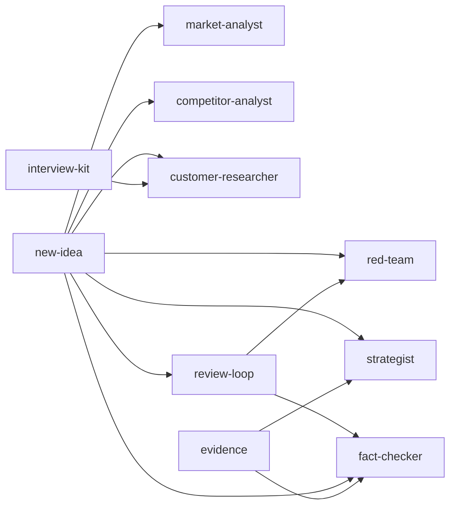

В плагине 6 субагентов. Оркестратор обращается к ним по полному имени, например `idea-pipeline:market-analyst`. У большинства несколько режимов: оркестратор называет режим в сообщении.

## Сводка

| Агент | Модель | Effort | Пишет файлы | Режимы | Роль |
|---|---|---|---|---|---|
| [market-analyst](market-analyst.md) | opus | high | `market.md` | research, fix | Определение рынка, TAM/SAM/SOM двумя-тремя способами, рост, сигналы существования рынка |
| [competitor-analyst](competitor-analyst.md) | opus | high | `competitors.md` | research, fix | Конкуренты, заменители, профили, карта позиционирования, пробелы, провалившиеся предшественники |
| [customer-researcher](customer-researcher.md) | opus | high | `customers.md`, `interviews/` | research, interview-kit, fix | Сегменты, JTBD, боли из голоса клиентов, процесс покупки, кандидаты в плацдарм, скрипты интервью |
| [strategist](strategist.md) | opus | high | `issue-tree.md`, `strategy.md`, `experiments.md`, `memo.md` | issue-tree, strategy, memo, fix | Дерево гипотез, синтез стратегии, memo с рекомендацией |
| [red-team](red-team.md) | opus | high | `preflight.md`, `risks.md`; в ревью ничего | pre-flight, pre-mortem, review | Быстрая проверка на «убийц», pre-mortem, атака на логику |
| [fact-checker](fact-checker.md) | sonnet | high | в ревью ничего; в оценке `readiness.md`, статусы и результаты | review, assess | Проверка источников и расчётов, оценка уровней готовности |

Все пишут только в `docs/idea/`, каждый — только свои файлы.

## Инструменты и ограничения

| Агент | Инструменты | `maxTurns` |
|---|---|---|
| market-analyst, competitor-analyst, customer-researcher, strategist | `Read, Grep, Glob, Write, Edit, WebSearch, WebFetch, Skill` | — |
| red-team, fact-checker | `Read, Grep, Glob, Write, Edit, WebSearch, WebFetch, Skill` | 60 |

Bash нет ни у кого: агентам он не нужен, а `idea-claims` запускает оркестратор. Ревьюеры red-team и fact-checker пишут файлы в других своих режимах, поэтому `Write` у них есть, а запрет на правки в режиме ревью задан в инструкциях, а не через `disallowedTools` ([Соглашения](../../development/conventions.md#агенты)).

## Навыки

| Агент | Предзагруженные навыки |
|---|---|
| market-analyst, competitor-analyst, customer-researcher | [`research-standards`](../skills/research-standards.md) |
| strategist, red-team, fact-checker | [`research-standards`](../skills/research-standards.md), [`readiness-levels`](../skills/readiness-levels.md) |

## Кто кого вызывает

