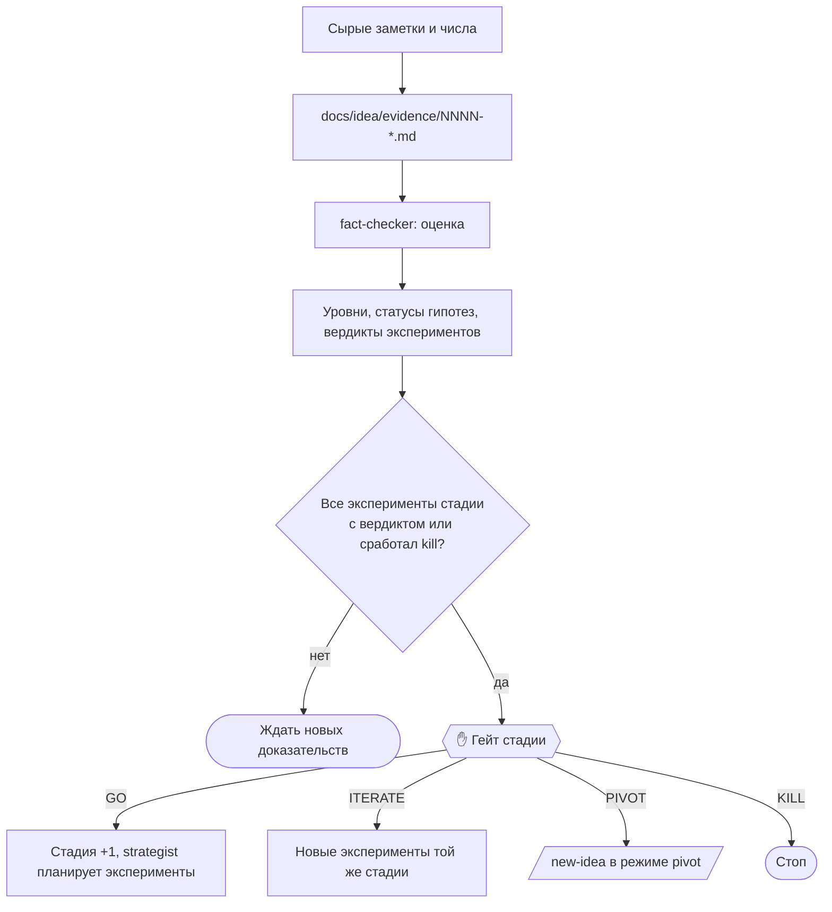

Записывает новое доказательство: интервью, звонок эксперту, результат smoke-теста, предзаказ, письмо о намерениях, пилот, опрос. После этого пересчитывает уровни готовности, сравнивает эксперименты с зафиксированными порогами и, когда доказательства собраны, проводит гейт стадии.

| | |
|---|---|
| Вызов | `/idea-pipeline:evidence [путь к заметкам или результатам, или короткое описание]` |
| Автовызов | Да, когда вы приносите заметки интервью или результаты эксперимента |
| Точки решения | Гейт стадии: GO, ITERATE, PIVOT, KILL |
| Исходник | `plugins/idea-pipeline/skills/evidence/SKILL.md` |

Работает только после [`new-idea`](new-idea.md): нужны `docs/idea/readiness.md` и `.claude/idea-pipeline.json`.

## Этапы

### 1. Сырой материал

Нужны сырые заметки и сырые числа: «14 регистраций из 310 посетителей», а не «около 5 %». Если вы только описали, что произошло, команда попросит заметки. Одно интервью или один результат — одна заметка.

### 2. Заметки-доказательства

`docs/idea/evidence/NNNN-<slug>.md` по шаблону:

- только факты: что люди рассказали о своём прошлом и что сделали. Цитаты на языке оригинала;
- мнения о будущем, комплименты и «я бы купил» помечаются и не засчитываются;
- обязательства: время, знакомство, данные, предоплата, письмо о намерениях. Или их нет;
- эксперимент и листья дерева гипотез, которые доказательство поддерживает или опровергает;
- сырые числа для метрики эксперимента;
- без лишних персональных данных: роль, сегмент и размер компании вместо имён.

### 3. Пересчёт

[fact-checker](../agents/fact-checker.md) в режиме оценки обновляет уровни в `readiness.md`, статусы листьев в `issue-tree.md` и результаты в `experiments.md`. Каждый эксперимент получает вердикт: **pass**, **kill** или **inconclusive** (между порогами или выборка меньше минимальной).

Если опровергнутая или подтверждённая гипотеза меняет картину в `customers.md` или `strategy.md`, команда предложит их обновить. Обновление идёт только с вашего согласия.

### 4. Гейт

Запускается, когда у всех экспериментов стадии есть вердикт, когда сработал порог kill или когда вы попросили. Вам показывают пороги рядом с измеренными значениями и номерами заметок. Изменения порогов после того, как результаты уже были видны, помечаются как **post-hoc**.

| Решение | Что происходит |
|---|---|
| GO | Стадия повышается в `.claude/idea-pipeline.json` и `readiness.md`. [strategist](../agents/strategist.md) планирует эксперименты следующей стадии и обновляет memo |
| ITERATE | Новые или изменённые эксперименты той же стадии |
| PIVOT | Запустите [`new-idea`](new-idea.md): она работает в режиме pivot |
| KILL | Стоп |

Решение записывается в журнал решений. Зафиксированный порог меняется только вашим явным решением с записью в журнале изменений порогов.

Когда стадия C пройдена, [`/web-pipeline:new-project`](../../web-pipeline/commands/new-project.md) может строить MVP и использует `docs/idea/`.
