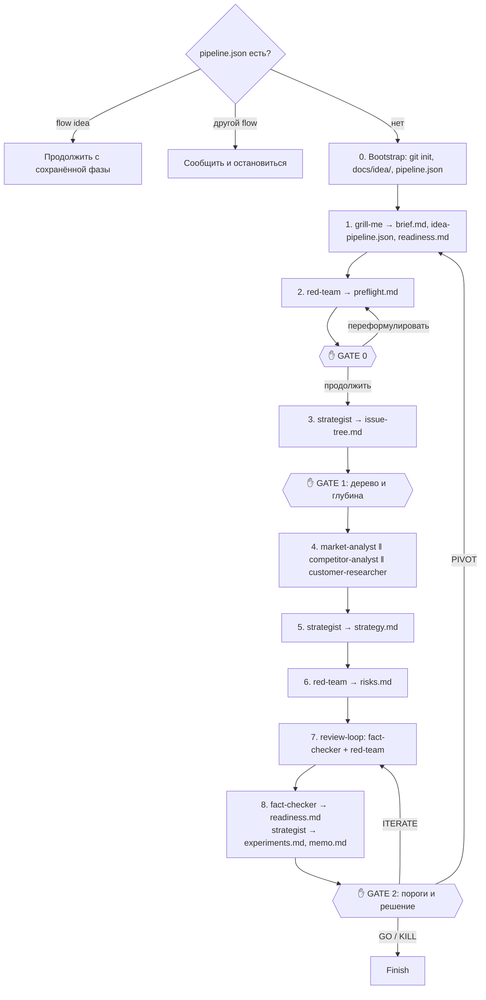

Исследование идеи от интервью до решения: быстрая проверка, дерево гипотез, параллельное исследование рынка, конкурентов и клиентов, стратегия, pre-mortem, проверка фактов, оценка готовности и memo с планом экспериментов.

| | |
|---|---|
| Вызов | `/idea-pipeline:new-idea [идея в нескольких словах]` |
| Автовызов | Нет (`disable-model-invocation: true`), только вручную |
| Точки решения | Подтверждение интервью, GATE 0 (быстрая проверка), GATE 1 (дерево гипотез и глубина), GATE 2 (пороги и решение) |
| Состояние | `.claude/state/pipeline.json` с `"flow": "idea"` на время запуска |
| Исходник | `plugins/idea-pipeline/skills/new-idea/SKILL.md` |

Одна папка проекта — одна идея. Исследование лежит в `docs/idea/`, настройки — в `.claude/idea-pipeline.json`.

## Этапы

### Resume first

- `pipeline.json` с `"flow": "idea"`: оркестратор говорит, где остановился прошлый запуск, и продолжает.
- `pipeline.json` с другим `flow`: в проекте идёт другой пайплайн. Оркестратор сообщает об этом и останавливается.
- Состояния нет, но есть `docs/idea/brief.md`: прошлый запуск завершён. Оркестратор спрашивает, это pivot той же идеи или новая идея. Новой идее нужна своя папка.

### Фаза 0. Bootstrap

1. `git init`, если папка ещё не репозиторий: ревью сравнивает снимки дерева.
2. Папки `docs/idea/` и `.claude/state/`, `.claude/state/` в `.gitignore`.
3. `.claude/state/pipeline.json`: `{ "flow": "idea", "phase": "intake" }`.

### Фаза 1. Интервью

[`dev-core:grill-me`](../../dev-core/skills/grill-me.md) по идее. После подтверждения пишутся:

- `docs/idea/brief.md`;
- `.claude/idea-pipeline.json` ([Конфигурация](../configuration.md));
- `docs/idea/readiness.md` с обязательными осями и предложенными порогами. Пороги пока не зафиксированы.

Дерево решений обязательно покрывает:

- проблему словами клиента, кто страдает первым и что люди делают сейчас;
- почему сейчас;
- **целевой рынок этой идеи**: география, языки исследования, валюта, модель (B2B, B2C, B2B2C, B2G; кто пользуется, кто платит, кто решает);
- идею монетизации и диапазон цены;
- команду, её время, **нечестные преимущества** и founder–market fit, бюджет и ограничения;
- амбицию (lifestyle или венчур) и **минимальный результат**, ради которого стоит этим заниматься;
- **условия остановки**, записанные до исследования;
- **обязательные оси готовности** (по умолчанию CRL, BRL, TRL, TMRL);
- **пороги гейтов** A → B, B → C, C → D и D → E. Значения по умолчанию из [readiness-levels](../skills/readiness-levels.md#пороги-по-умолчанию) предлагаются как рекомендованные ответы, решаете вы.

Размер рынка, конкурентов и факты о клиентах у вас не спрашивают: их находит исследование.

**Режим pivot**: интервью только о том, что меняется (сегмент, проблема, решение, модель, канал) и почему. Строка в журнале pivot в `brief.md`, затем сразу фаза 3. Прежнее исследование остаётся в истории git.

### Фаза 2. Быстрая проверка → GATE 0

[red-team](../agents/red-team.md) в режиме pre-flight, около десятка поисков: доминирующие игроки и бесплатные альтернативы, провалившиеся предшественники, регуляторные и платформенные блокеры. Результат — `docs/idea/preflight.md` с вердиктом green, yellow или red.

**GATE 0**: продолжить, переформулировать идею (и повторить проверку) или остановиться. Остановка записывается как KILL в журнал решений.

### Фаза 3. Дерево гипотез → GATE 1

[strategist](../agents/strategist.md) пишет `docs/idea/issue-tree.md`: главный вопрос, гипотеза и пять ветвей.

| Ветвь | Вопрос |
|---|---|
| H1 Desirability | Проблема есть, она острая и частая, текущие альтернативы не справляются |
| H2 Viability | Рынок больше минимального результата, клиенты платят достаточно, юнит-экономика сходится |
| H3 Feasibility | Можем построить доступными технологиями и силами |
| H4 Defensibility | Можем выиграть у действующих игроков и удержать выигранное |
| H5 Fit with us | Команда, её преимущества и ограничения подходят идее |

У каждого листа есть условия подтверждения и опровержения, важность, текущие доказательства и ответственный.

**GATE 1**: вы утверждаете или правите дерево и выбираете глубину: `light`, `standard` или `deep` ([что это значит](../skills/research-standards.md#уровни-глубины)).

### Фаза 4. Исследование

1. Снимок [`git-snapshot`](../../dev-core/git-snapshot.md) сохраняется как `research_base`: от него ревью считает diff.
2. Параллельно, одним сообщением: [market-analyst](../agents/market-analyst.md) → `market.md`, [competitor-analyst](../agents/competitor-analyst.md) → `competitors.md`, [customer-researcher](../agents/customer-researcher.md) → `customers.md`.
3. [`idea-claims docs/idea`](../idea-claims.md). Ошибки один раз уходят владельцу файла.
4. Разделы **Data requests** показываются вам: какие выгрузки (Wordstat, платные базы) уточнили бы какие цифры. Пайплайн их не ждёт. Если вы пришлёте данные, владелец файла добавит их как источник `user-provided`.

### Фаза 5. Стратегия

[strategist](../agents/strategist.md) пишет `strategy.md`: плацдарм, ценностное предложение, позиционирование, конкурентное преимущество по семи силам Хелмера, go-to-market и путь к первым 100 клиентам, модель и юнит-экономику диапазонами, техническую реализуемость.

### Фаза 6. Pre-mortem

[red-team](../agents/red-team.md) пишет `risks.md`: «прошло два года, идея провалилась — почему?», самые рискованные допущения, реестр рисков, проверку условий остановки и замеченные искажения.

### Фаза 7. Ревью

[`dev-core:review-loop`](../../dev-core/skills/review-loop.md):

| Вход | Значение |
|---|---|
| Ревьюеры | [fact-checker](../agents/fact-checker.md) (`FC-`) и [red-team](../agents/red-team.md) (`RT-`) в режиме ревью |
| Исправляющие | Владелец каждого файла в режиме fix |
| База | `research_base` |
| Документы | `brief.md`, `issue-tree.md`, `idea-pipeline.json` |
| Команда проверки | `idea-claims docs/idea` |
| Максимум раундов | 2 |

### Фаза 8. Готовность и memo

1. [fact-checker](../agents/fact-checker.md) в режиме оценки выставляет уровни по осям в `readiness.md` и статусы листьев дерева.
2. [strategist](../agents/strategist.md) пишет `experiments.md` (эксперименты стадии B с порогами) и `memo.md`: рекомендация первой, три причины, «что должно быть правдой», план на 30 дней.

### GATE 2. Решение

Вам показывают рекомендацию, дерево готовности со слабым звеном, первые эксперименты с порогами, главные риски и состояние условий остановки.

1. Вы подтверждаете или меняете пороги гейтов, и они **фиксируются**: в `readiness.md` ставится дата.
2. Вы решаете: **GO** (стадия B), **ITERATE** (углубить исследование и снова на ревью), **PIVOT** (интервью об изменении и заново с дерева гипотез) или **KILL**.
3. Решение записывается в журнал решений `readiness.md`.

### Finish

`pipeline.json` и `review-loop.json` удаляются: запуск окончен, а прогресс идеи живёт в `docs/idea/` и `.claude/idea-pipeline.json`. Пайплайн предлагает закоммитить их и рассказывает, что дальше: [`interview-kit`](interview-kit.md), [`evidence`](evidence.md), [`readiness`](readiness.md).

## Кто задействован

| Этап | Агенты и скиллы |
|---|---|
| 1 | [`dev-core:grill-me`](../../dev-core/skills/grill-me.md), [readiness-levels](../skills/readiness-levels.md) |
| 2, 6 | [red-team](../agents/red-team.md) |
| 3, 5, 8 | [strategist](../agents/strategist.md) |
| 4 | [market-analyst](../agents/market-analyst.md), [competitor-analyst](../agents/competitor-analyst.md), [customer-researcher](../agents/customer-researcher.md), [`idea-claims`](../idea-claims.md) |
| 7 | [`dev-core:review-loop`](../../dev-core/skills/review-loop.md) с [fact-checker](../agents/fact-checker.md) и [red-team](../agents/red-team.md) |
| 8 | [fact-checker](../agents/fact-checker.md), [strategist](../agents/strategist.md) |

## Какие файлы создаёт

`docs/idea/brief.md`, `preflight.md`, `issue-tree.md`, `market.md`, `competitors.md`, `customers.md`, `strategy.md`, `risks.md`, `readiness.md`, `experiments.md`, `memo.md`, `.claude/idea-pipeline.json`, `TODO.md` (отложенные мелкие находки ревью). Подробно на странице [Файлы в проекте](../project-files.md).

## Типичные проблемы

- **Хочу начать заново, а он продолжает старый запуск.** Удалите `.claude/state/pipeline.json`.
- **В memo мало цифр по спросу.** У агентов нет доступа к Wordstat и Keyword Planner. Выгрузите данные по разделу Data requests и передайте их: они попадут в исследование как источник `user-provided`.
- **Рекомендация GO, но вы не уверены.** GO после кабинетного исследования значит только «стоит проверить на людях». Настоящую проверку дают эксперименты стадии B.
- **Исследование долгое и дорогое.** Выберите глубину `light` на GATE 1. Каждый исследователь работает на Opus.
