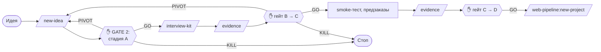

Проверка идеи продукта до того, как её строить: рынок, конкуренты, целевая аудитория, УТП, конкурентное преимущество, путь к своей доле рынка и план экспериментов. Цель — не сделать продукт, который никому не нужен.

```bash
claude plugin install idea-pipeline@nikiquark-ai-plugins   # dev-core ставится как зависимость
```

## Принципы

- **Метод, а не объём текста.** Работа идёт от гипотезы через дерево вопросов, ветки которого не пересекаются и покрывают всё (MECE). Рынок считается минимум двумя независимыми способами и даётся диапазоном. Вывод стоит первым, у каждого вывода указан уровень уверенности. Правила собраны в навыке [research-standards](skills/research-standards.md).
- **Ни одной цифры без источника.** Каждая цифра помечена: источник `[S3]`, расчёт `[calc]`, оценка `[est]`, гипотеза `[hyp]` или слова основателя `[user]`. Команда [`idea-claims`](idea-claims.md) находит цифры без метки, а [fact-checker](agents/fact-checker.md) открывает источники и проверяет, что цифра действительно там есть.
- **Кабинетное исследование — это ещё не валидация.** Исследование даёт гипотезы, сигналы и план экспериментов. Следующие уровни готовности требуют живых доказательств: интервью, smoke-тестов, предзаказов.
- **Готовность измеряется доказательствами.** [Дерево готовности KTH](skills/readiness-levels.md): шесть осей по девять уровней. Общий уровень равен минимуму по обязательным осям.
- **Пороги задаются заранее.** Пороги переходов задаются для каждой идеи на интервью и фиксируются до экспериментов. Задним числом их не сдвинуть незаметно.
- **Красная команда.** [red-team](agents/red-team.md) ищет причины, по которым идея провалится: на быстрой проверке, в pre-mortem и на ревью.

## Жизненный цикл идеи



## Команды

| Команда | Что делает |
|---|---|
| [`/idea-pipeline:new-idea <идея>`](commands/new-idea.md) | grill-me → `brief.md` → быстрая проверка ✋ → дерево гипотез ✋ → рынок, конкуренты и клиенты параллельно → стратегия → pre-mortem → ревью фактов, не больше двух раундов → уровни готовности → memo и решение ✋ |
| [`/idea-pipeline:evidence [заметки]`](commands/evidence.md) | Интервью или результат эксперимента → заметка-доказательство → пересчёт уровней → вердикт по порогам → гейт стадии ✋ |
| [`/idea-pipeline:readiness`](commands/readiness.md) | Дерево готовности, слабое звено, эксперименты и ближайшие milestones. Только чтение |
| [`/idea-pipeline:interview-kit [сегмент]`](commands/interview-kit.md) | Скрипт интервью по The Mom Test, скринер, где искать респондентов |

✋ означает, что пайплайн ждёт вашего решения ([все точки решения](../concepts/gates.md)).

## Стадии

| Стадия | Вопрос | Как проходится |
|---|---|---|
| A. Кабинетное исследование | Стоит ли проверять это на людях? | `new-idea` |
| B. Проверка проблемы | Есть ли у этих людей эта проблема, и насколько она острая? | Интервью: `interview-kit`, `evidence` |
| C. Проверка спроса и решения | Захотят ли они наше решение по этой цене? | Smoke-тест, предзаказы, прототип: `evidence` |
| D. MVP и product-market fit | Пользуются ли и платят ли? | Продукт, например через `web-pipeline` |
| E. Масштаб | Растёт ли это повторяемо и прибыльно? | — |

Целевые уровни каждой стадии и пороги по умолчанию — на странице [readiness-levels](skills/readiness-levels.md).

## Состав плагина

| Каталог | Содержимое | Документация |
|---|---|---|
| `skills/` (команды) | `new-idea`, `evidence`, `readiness`, `interview-kit` | [Команды](commands/new-idea.md) |
| `agents/` | 6 субагентов | [Субагенты](agents/index.md) |
| `skills/` (знания) | `research-standards`, `readiness-levels` | [research-standards](skills/research-standards.md), [readiness-levels](skills/readiness-levels.md) |
| `bin/` | `idea-claims` | [idea-claims](idea-claims.md) |
| `templates/` | Шаблоны всех файлов `docs/idea/` и `idea-pipeline.json` | [Файлы в проекте](project-files.md), [Конфигурация](configuration.md) |

Хуков у плагина нет, поэтому в других проектах он ничего не делает.

## Связь с другими плагинами

- Из [dev-core](../dev-core/index.md): [`grill-me`](../dev-core/skills/grill-me.md) для интервью, [`review-loop`](../dev-core/skills/review-loop.md) для проверки фактов и логики, [`git-snapshot`](../dev-core/git-snapshot.md) для базы ревью.
- В [web-pipeline](../web-pipeline/index.md): когда стадия C пройдена, [`new-project`](../web-pipeline/commands/new-project.md) находит `docs/idea/memo.md` и берёт сегменты, ценностное предложение, конкурентов и доказательства в спецификацию, не спрашивая заново.

## Модели

| Агент | Модель | Effort |
|---|---|---|
| [market-analyst](agents/market-analyst.md) | Opus | high |
| [competitor-analyst](agents/competitor-analyst.md) | Opus | high |
| [customer-researcher](agents/customer-researcher.md) | Opus | high |
| [strategist](agents/strategist.md) | Opus | high |
| [red-team](agents/red-team.md) | Opus | high |
| [fact-checker](agents/fact-checker.md) | Sonnet | high |
