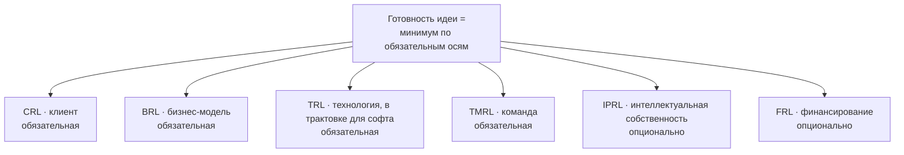

Дерево готовности идеи по модели **KTH Innovation Readiness Level** (KTH Innovation, Стокгольм): шесть осей по девять уровней. Идея готова к следующему шагу, когда это говорят доказательства, а не презентация.

| | |
|---|---|
| Вызов | `/idea-pipeline:readiness-levels` или автоматически для оценки готовности, планирования экспериментов и решения о переходе |
| Предзагружен в | [strategist](../agents/strategist.md), [red-team](../agents/red-team.md), [fact-checker](../agents/fact-checker.md) |
| Загружается в | Фазе 1 [`new-idea`](../commands/new-idea.md) для порогов |
| Исходник | `plugins/idea-pipeline/skills/readiness-levels/SKILL.md`, критерии уровней — `references/kth-irl.md` |

## Когда срабатывает

> The readiness tree for a product idea, based on the KTH Innovation Readiness Level - six axes (customer, business, technology, team, IPR, funding) with nine levels each, how to score them from evidence, the overall level as the weakest required axis, the stages A-E with their target levels, default gate thresholds, pre-registration and locking of thresholds, and the GO/ITERATE/PIVOT/KILL decision. Load for scoring readiness, planning experiments, or deciding whether an idea moves to the next stage.

## Дерево

Какие оси обязательны, решается на интервью для каждой идеи (`required_axes` в [конфигурации](../configuration.md)). IPRL для софта обычно не нужна. FRL нужна, только если план зависит от внешних денег. Ось, которая задаёт общий уровень, называется **слабым звеном**: туда идут следующие усилия.

## Уровни коротко

| Уровень | CRL · клиент | BRL · бизнес-модель | TRL · технология (софт) | TMRL · команда |
|---|---|---|---|---|
| 1 | Догадка о потребности | Расплывчатая бизнес-идея | Известны принципы, API и данные, на которые опирается продукт | Один человек, мало понимания, кто нужен |
| 2 | Кабинетное исследование, потребность описана конкретно | Концепция описана, грубый TAM, список конкурентов | Техническая концепция: архитектура, критичные компоненты, сделать или купить | Есть идея, какие компетенции нужны |
| 3 | Первые разговоры с клиентами или экспертами | Канва без выручки и затрат, TAM и SAM, полный обзор конкурентов | Proof of concept самой рискованной части на реалистичных данных | Часть компетенций есть, пробелы и план на год |
| 4 | Проблема подтверждена несколькими клиентами (B2B 5–10, B2C больше) | Полная канва с выручкой и затратами, расчёт снизу вверх, SOM, анализ отличий | Компоненты работают вместе в среде разработки | Есть лидер, набор людей начат, обсуждаются роли и доли |
| 5 | Интерес к решению, ключевые функции решают проблему | Части модели проверены на клиентах, гипотезы цены, отличия подтверждены рынком | Проверка в реалистичной среде: объёмы, интеграции, staging | Команда основателей, доли подписаны |
| 6 | Клиенты протестировали продукт и подтвердили ценность, пилоты | Модель с ценой проверена тестовыми продажами | Прототип всей системы на реальных задачах | Полная команда для ближайших задач, есть советники |
| 7 | Первые продажи или платные пилоты | Product–market fit, клиенты платят, прогнозы подтверждены продажами | Работает в боевой среде с реальными пользователями | Культура и роли, план найма на два года |
| 8 | Продажи нескольким клиентам, готовность платить подтверждена (PMF) | Метрики показывают, что модель масштабируется, CAC под контролем | Система завершена и проверена во всех сценариях | Сильное руководство, совет, долгосрочный найм |
| 9 | Повторяемые масштабируемые продажи | Модель окончательна, бизнес прибыльно растёт | Доказана длительной эксплуатацией | Устойчивая сильная организация |

Полные критерии всех шести осей, включая IPRL и FRL, — в `references/kth-irl.md`.

## Как выставляется уровень

- Ось на уровне N, если закрыты критерии уровня N **и всех ниже**. Половинок и округления вверх нет.
- У каждого уровня есть ссылка на доказательство: раздел файла `docs/idea/`, заметка `evidence/NNNN-*.md` или результат эксперимента.
- **Кабинетное исследование не считается доказательством от клиентов.** Оно доводит CRL максимум до 2, BRL до 4, TRL до 2.
- Слова основателя (`[user]`) годятся для TMRL и для стартовой точки, но не для CRL и BRL выше 2.
- По каждой обязательной оси записывается, чего не хватает до следующего уровня.
- Если подходят два уровня, выбирается нижний.

## Стадии и целевые уровни

| Стадия | Вопрос | CRL | BRL | TRL | TMRL |
|---|---|---|---|---|---|
| A. Кабинетное исследование | Стоит ли проверять на людях? | 2 | 4 | 2 | 3 |
| B. Проверка проблемы | Есть ли проблема, и насколько острая? | 4 | 4 | 3 | 4 |
| C. Проверка спроса и решения | Захотят ли решение и заплатят ли эту цену? | 6 | 6 | 4 | 5 |
| D. MVP и PMF | Пользуются ли и платят ли? | 8 | 7 | 7 | 6 |
| E. Масштаб | Растёт ли повторяемо и прибыльно? | 9 | 9 | 9 | 8 |

Цели для IPRL и FRL, если они обязательны, задаются на интервью.

## Пороги по умолчанию

Пороги задаются **для каждой идеи на интервью**. Это значения, которые пайплайн предлагает как рекомендацию, решаете вы.

| Гейт | Метрика | Pass | Kill |
|---|---|---|---|
| A → B | Кабинетное исследование | Нет неотвеченных красных флагов, базовый SOM ≥ минимального результата, есть достижимый плацдарм | Сильная бесплатная альтернатива, SOM ниже минимума во всех сценариях |
| B → C | Интервью о проблеме | B2B 5–10, B2C 10–20 в сегменте плацдарма, без питча решения | — |
| | Проблема подтверждена | ≥ 60 % ставят её в топ-3 и уже тратят деньги или время на обходной путь | < 30 % |
| | Обязательства | ≥ 30 % дают обязательство: встреча, знакомство, пилот, предоплата | < 10 % |
| C → D | Smoke-тест | ≥ 5 % посетитель → регистрация на ≥ 300 целевых посетителях (B2C); ≥ 3 письма о намерениях или платных пилота (B2B) | < 1,5 % или 0 писем |
| | Готовность платить | ≥ 10 предзаказов или депозитов (B2C) по плановой цене; плановая цена в приемлемом диапазоне ценового опроса | Никто не платит ни по одной цене |
| | Решение | ≥ 4 из 5 пользователей выполняют основную задачу в прототипе | ≤ 2 из 5 |
| D → E | Product–market fit | ≥ 40 % «очень расстроюсь» в опросе Шона Эллиса (≥ 40 активных пользователей), кривая удержания выходит на плато | < 25 %, удержание падает к нулю |
| | Юнит-экономика | LTV / CAC ≥ 3, окупаемость CAC ≤ 12 месяцев | LTV / CAC < 1 |

Результат между pass и kill — неопределённый. Он ведёт к ITERATE и никогда не ведёт к GO.

## Фиксация порогов

- До конца [`new-idea`](../commands/new-idea.md) пороги меняются свободно. На GATE 2 они фиксируются: в `readiness.md` ставится дата.
- После фиксации порог меняется только вашим явным решением, с записью в журнал изменений: дата, было, стало, причина, видели ли уже результаты. Изменение после того, как результаты были видны, помечается **post-hoc**, и решение, которое на него опирается, говорит об этом.
- Незаметно ослабить порог, чтобы идея прошла, нельзя.

## Решения

| Решение | Когда | Что дальше |
|---|---|---|
| GO | Пороги pass выполнены | Следующая стадия |
| ITERATE | Результат неопределённый | Та же стадия, изменённые эксперименты |
| PIVOT | Опровергнута ключевая гипотеза: сегмент, проблема, решение, модель или канал | [`new-idea`](../commands/new-idea.md) в режиме pivot, с дерева гипотез |
| KILL | Сработал kill или нет правдоподобного pivot | Стоп с записанными причинами |

KILL с ясными причинами — хороший результат: это время, не потраченное на продукт, который никому не нужен.
