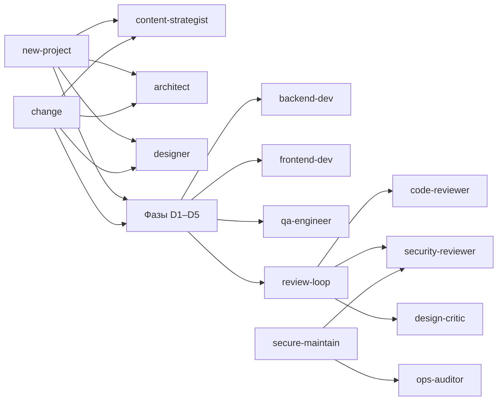

В плагине 10 субагентов. У каждого свой контекст, модель, effort, набор инструментов и предзагруженные навыки. Оркестратор обращается к ним по полному имени, например `web-pipeline:architect`.

## Сводка

| Агент | Модель | Effort | Пишет файлы | Роль |
|---|---|---|---|---|
| [content-strategist](content-strategist.md) | opus | high | только `docs/` | Главная мысль, карта страниц, тексты, SEO-метаданные: `docs/content.md` |
| [architect](architect.md) | opus | high | только `docs/` | Архитектура, ADR, «готовое или своё», план; аудит существующего кода |
| [designer](designer.md) | opus | high | `docs/design*` | Дизайн-концепты в HTML, дизайн-система `docs/design.md`, шаблон OG-картинки |
| [backend-dev](backend-dev.md) | sonnet | medium | да | Каркас, API-контракт, серверная логика по TDD |
| [frontend-dev](frontend-dev.md) | sonnet | high | да | Интерфейс строго по `docs/design.md` и `docs/content.md` |
| [qa-engineer](qa-engineer.md) | sonnet | medium | да | Playwright e2e по критериям приёмки |
| [code-reviewer](code-reviewer.md) | opus | high | нет | Корректность, переиспользование, простота, тесты |
| [security-reviewer](security-reviewer.md) | opus | high | нет | OWASP, авторизация, секреты, зависимости |
| [design-critic](design-critic.md) | opus | medium | нет | Проверка интерфейса по скриншотам: смысл, сдержанность, стиль, `make seo` |
| [ops-auditor](ops-auditor.md) | haiku | medium | нет | Сканеры уязвимостей по репозиторию, образам и хостам |

`opus`, `sonnet` и `haiku` — псевдонимы, они указывают на текущие версии моделей (сейчас Opus 5.5, Sonnet 5.5, Haiku 5.5).

## Инструменты и ограничения

| Агент | Инструменты | Запрещено | `maxTurns` |
|---|---|---|---|
| content-strategist | `Read, Grep, Glob, Write, Edit, WebSearch, WebFetch, Skill` | — | — |
| architect, designer | `Read, Grep, Glob, Bash, Write, Edit, WebSearch, WebFetch, Skill` | — | — |
| backend-dev, frontend-dev, qa-engineer | Все инструменты сессии | — | — |
| code-reviewer, security-reviewer, design-critic | Все, кроме запрещённых | `Write, Edit, NotebookEdit, Agent` | 40 |
| ops-auditor | Все, кроме запрещённых | `Write, Edit, NotebookEdit, Agent` | 60 |

Плагинные агенты игнорируют `permissionMode`, `hooks` и `mcpServers` во frontmatter, поэтому «только чтение» обеспечивается через `disallowedTools`. Bash у ревьюеров остаётся: он нужен для запуска тестов и сканеров, а запрет на изменения задан в их инструкциях.

## Навыки

| Агент | Предзагруженные навыки |
|---|---|
| content-strategist | `seo-standards` |
| architect | `backend-standards`, `ansible-conventions`, `seo-standards`, `dev-core:reuse-first` |
| designer | `frontend-style` |
| backend-dev | `backend-standards`, `testing-standards`, `dev-core:reuse-first` |
| frontend-dev | `frontend-style`, `seo-standards`, `testing-standards`, `dev-core:reuse-first` |
| qa-engineer | `testing-standards` |
| code-reviewer | `backend-standards`, `testing-standards`, `dev-core:reuse-first` |
| security-reviewer | `backend-standards`, `ansible-conventions` |
| design-critic | `frontend-style`, `seo-standards` |
| ops-auditor | `ansible-conventions` |

Если навык из конфигурации не попал в контекст, агент сам загружает его инструментом `Skill`.

## Кто кого вызывает

## Переопределение моделей

- `CLAUDE_CODE_SUBAGENT_MODEL=<model>` вместе с `CLAUDE_CODE_SUBAGENT_MODEL_FORCE=1` переводит всех субагентов на одну модель, например для экономии.
- Единственное автоматическое переопределение — эскалация на `opus` после двух неудачных `make check` ([D3](../delivery.md#d3-задачи-плана), [review-loop](../../dev-core/skills/review-loop.md#эскалация)).
