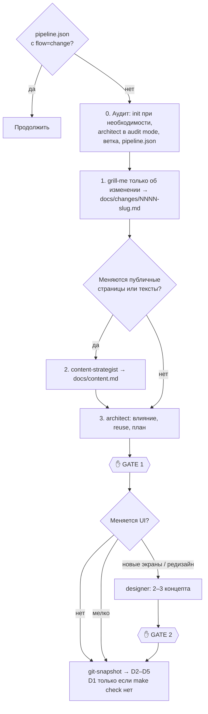

Доработка существующего веб-проекта: фича, исправление, рефакторинг или редизайн. Сначала аудит кода, затем интервью только об изменении, обновление смысла и текстов, если меняются публичные страницы, план с анализом влияния, реализация, проверки, ревью и локальная проверка.

| | |
|---|---|
| Вызов | `/web-pipeline:change [что изменить]` |
| Автовызов | Нет (`disable-model-invocation: true`), только вручную |
| Точки решения | Подтверждение интервью, GATE 1 (влияние и план), GATE 2 (только для новых экранов или редизайна), D5 |
| Состояние | `.claude/state/pipeline.json` с `"flow": "change"` и `change_doc` |
| Ветка | `change/<short-slug>` |
| Исходник | `plugins/web-pipeline/skills/change/SKILL.md` |

## Этапы

### Фаза 0. Аудит: факты раньше вопросов

1. Если нет `.claude/web-pipeline.json`, вызывается [`init`](init.md). На унаследованном коде init настраивает anti-slop проверять только изменённые файлы.
2. Если `docs/architecture.md` нет или он устарел, [`architect`](../agents/architect.md) запускается в **audit mode** и пишет фактическое описание проекта: стек, модули и их границы, утилиты и общие компоненты, которые стоит переиспользовать, тестовая инфраструктура, как устроен деплой (`deploy/ansible`), известный долг. Если документ актуален, оркестратор читает его сам.
3. Создаётся ветка `change/<short-slug>`.
4. `.claude/state/pipeline.json`: `{ "flow": "change", "phase": "requirements", "change_doc": "docs/changes/NNNN-<slug>.md" }`, где NNNN — следующий свободный номер.

### Фаза 1. Интервью только об изменении

[`dev-core:grill-me`](../../dev-core/skills/grill-me.md) получает аудит как известные факты и никогда не спрашивает то, что видно из кода. Темы:

- изменение поведения и критерии приёмки;
- кого это затрагивает;
- совместимость: миграции данных, потребители API, URL и SEO;
- выкатка: с feature flag или без;
- что не должно измениться;
- если появляются, удаляются или переименовываются публичные страницы или меняется то, что они говорят: что должны донести затронутые страницы и какое одно действие они предлагают.

Результат пишется в документ изменения по [шаблону change.md](../templates.md#changemd).

### Фаза 2. Смысл и тексты (только если меняются публичные страницы или их тексты)

[`content-strategist`](../agents/content-strategist.md) в режиме обновления получает документ изменения и `docs/content.md`. Он обновляет затронутые страницы (сообщение, секции, тексты, метаданные) или создаёт файл для этих страниц, если его не было. Для каждого переименованного или удалённого URL он записывает 301-редирект. Изменения, которые не касаются ни публичных страниц, ни текстов для пользователя, эту фазу пропускают.

### Фаза 3. Влияние и план → GATE 1

`architect` получает документ изменения, `docs/architecture.md` и `docs/content.md`, если он есть, и дописывает в документ:

- анализ влияния: затронутые модули, миграции, изменения контракта, риск;
- решения «готовое или своё»;
- план задач.

Если решение архитектурное, architect пишет ADR. План записывается в `docs/plan.md`, а для маленьких изменений — прямо в документ изменения. Вместе с планом вам показывают изменения в текстах и редиректы, если работала фаза 2. **GATE 1**: явное утверждение.

### Фаза 4. Дизайн (только если меняется UI)

- **Небольшое изменение UI:** без точки решения. Фронтенд следует `docs/design.md` и текстам из `docs/content.md`, если он есть. Если этого файла нет, designer сначала извлекает дизайн-систему из текущего UI (extract mode).
- **Новые экраны или визуальная переработка:** [`designer`](../agents/designer.md) делает 2–3 концепта в рамках существующей дизайн-системы, или радикальные, если вы просили редизайн. **GATE 2**: вы выбираете, designer обновляет `docs/design.md`.

### Фаза 5 и дальше. Реализация

Снимок `git-snapshot` сохраняется как `implementation_base`. Затем выполняются [D2–D5](../delivery.md):

- D1 — только если `make check` нет или он сломан;
- D2 пропускается, если API-контракт не меняется.

Дополнительные правила для существующего кода:

- Следовать соглашениям, которые уже приняты в коде, даже если стандарты плагина говорят иное, пока документ изменения не требует миграции. Конфликт записывается как отложенная находка. Код, который не просили трогать, не переписывается.
- Любое поведение из раздела «Must not change» получает **характеризационный тест до** изменения кода.

## Кто задействован

| Этап | Агенты и скиллы |
|---|---|
| 0 | [`init`](init.md), [architect](../agents/architect.md) (audit) |
| 1 | [`dev-core:grill-me`](../../dev-core/skills/grill-me.md) |
| 2 | [content-strategist](../agents/content-strategist.md) (update) |
| 3 | [architect](../agents/architect.md) |
| 4 | [designer](../agents/designer.md) (concepts или extract) |
| D2–D5 | Как в [фазах реализации](../delivery.md) |

## Какие файлы создаёт или меняет

`docs/changes/NNNN-<slug>.md`, при необходимости `docs/content.md`, `docs/architecture.md`, `docs/adr/`, `docs/plan.md`, `docs/design.md`, код и тесты в ветке `change/<slug>`.

## Типичные проблемы

- **Claude спрашивает то, что есть в коде.** Это нарушение правила фазы 1. Ответьте, что это видно из кода, или попросите обновить аудит.
- **Старый код валит anti-slop.** Проверьте, что `make check` запускает `anti_slop.py --since origin/main` ([init](init.md), шаг 3).
- **Не хочу менять ветку.** Скажите об этом на фазе 0, до создания ветки.
