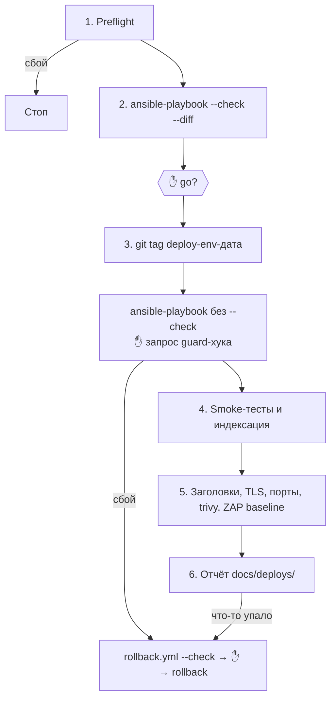

Деплой текущего проекта в staging или production через Ansible: preflight, dry run с вашим утверждением, применение, smoke-тесты, проверки безопасности после деплоя, отчёт и предложение отката.

| | |
|---|---|
| Вызов | `/web-pipeline:deploy [staging|production]` (по умолчанию `staging`) |
| Автовызов | Нет (`disable-model-invocation: true`), только вручную |
| Точки решения | Dry run (явное «go»), запрос guard-хука на применение, решение по critical/high находкам, откат |
| Цели | Только хосты из `deploy/ansible/inventories/<env>/` |
| Стандарт | [`ansible-conventions`](../skills/ansible-conventions.md) |
| Отчёт | `docs/deploys/<YYYY-MM-DD>-<env>.md` |
| Исходник | `plugins/web-pipeline/skills/deploy/SKILL.md` |

Production требует, чтобы тот же коммит уже был зелёным на staging, если вы явно не сказали иначе.

## Этапы



### 1. Preflight

Остановка на первом сбое:

- рабочая копия чистая, ветка та, которую вы хотите выкатить (обычно `main`);
- `make check` проходит;
- `ansible-playbook --syntax-check` проходит, `ansible-lint` чистый;
- vault доступен без вывода секретов: `ansible-inventory -i inventories/<env> --list >/dev/null`;
- для production: подтверждается SHA коммита, который сейчас на staging (из последнего отчёта о деплое);
- миграции в этом релизе перечисляются, и о каждой необратимой вас явно предупреждают.

### 2. Dry run → GATE

```bash
ansible-playbook -i inventories/<env> playbooks/deploy.yml --check --diff
```

Если менялись роли, вместо `deploy.yml` используется `site.yml`. Вам показывают, что изменится на каких хостах (пакеты, конфиги, сервисы, релиз) с выдержками diff. Пайплайн **ждёт явного «go»**. При реальном запуске [guard-хук](../hooks.md#guard-bash) ещё раз спросит разрешения, и это ожидаемо.

### 3. Применение

- Ставится тег `git tag -a deploy-<env>-<YYYYMMDD-HHMM> -m "deploy <env>"`. Тег не пушится, если вы не попросите.
- Плейбук запускается без `--check`. При сбое пайплайн останавливается, показывает упавшую задачу и её вывод и предлагает откат. Слепых повторов не бывает.

### 4. Smoke-тесты и индексация

- `playbooks/smoke.yml`, если он есть. Иначе `curl -fsS` по `/healthz`, `/readyz` и ключевым маршрутам из `docs/spec.md` с проверкой кодов ответа и времени.
- Playwright-тесты с тегом `@smoke` с `BASE_URL=<url окружения>`, если они есть.
- **Индексация:** [`seo_check.py`](../seo-check.md) по адресу окружения. Если в проекте нет копии, используется копия из плагина.
    - Staging всегда проверяется с `--expect noindex`.
    - Production проверяется с `--expect index`, если `docs/content.md` не говорит, что приложение закрытое.
    - Production, который закрыт от роботов, или staging, который может попасть в поиск, — находка уровня high.

### 5. Проверки безопасности после деплоя

Только для своих хостов. Запускается то, что установлено. Чего нет, перечисляется с подсказками по установке, а не пропускается молча.

| Проверка | Команда | Что смотрим |
|---|---|---|
| Заголовки | `curl -sI https://<host>` | HSTS, CSP, X-Content-Type-Options, Referrer-Policy, frame-ancestors / X-Frame-Options; нет версий в `Server` и `X-Powered-By` |
| TLS | `testssl.sh --quiet --severity MEDIUM https://<host>` или `openssl s_client` | Протоколы, шифры, срок сертификата |
| Порты | `nmap -Pn --top-ports 200 <host>` | Открыты только 22, 80, 443 или задокументированные |
| Образы и ФС | `trivy image <image:tag>` или `trivy fs` на хосте через Ansible | Известные CVE |
| Пассивный DAST | `docker run --rm -t ghcr.io/zaproxy/zaproxy:stable zap-baseline.py -t https://<host>` | Только пассивный режим, никогда не активное сканирование |

Каждая находка классифицируется как critical, high, medium или low. При critical или high пайплайн рекомендует откат или срочное исправление, решаете вы.

### 6. Отчёт и откат

`docs/deploys/<YYYY-MM-DD>-<env>.md`: SHA коммита, тег, длительность, изменения, результаты smoke-тестов, находки безопасности и решения по ним. Если что-то упало, предлагается `playbooks/rollback.yml`: сначала с `--check`, а применение только после вашего утверждения.

## Что нужно в проекте

Структура `deploy/ansible/` из [`ansible-conventions`](../skills/ansible-conventions.md#структура): `inventories/<env>/`, `playbooks/deploy.yml`, `site.yml`, `rollback.yml`, желательно `smoke.yml`. Её проектирует [architect](../agents/architect.md) и пишет [backend-dev](../agents/backend-dev.md) в рамках плана.

## Типичные проблемы

- **Guard-хук спрашивает разрешение.** Это нормально для запуска без `--check`. Разрешайте, только если это тот деплой, о котором вы договорились.
- **Production отказывается деплоиться.** Этот коммит ещё не был на staging. Выкатите на staging или явно скажите, что делаете исключение.
- **Staging проваливает проверку индексации.** Включите `proxy_noindex: true` в `inventories/staging/group_vars/all/vars.yml` ([`ansible-conventions`](../skills/ansible-conventions.md)) и выкатите `site.yml`.
- **Нет `testssl.sh`, `nmap` или `docker`.** Проверка будет пропущена с подсказкой по установке, остальные выполнятся.
