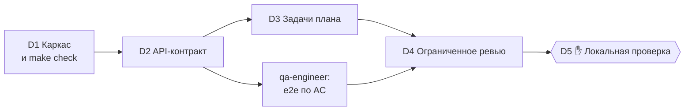

Общие фазы для [`new-project`](commands/new-project.md) и [`change`](commands/change.md). Они начинаются после утверждения плана. Оркестратор делегирует и отслеживает, а сам код приложения не пишет, кроме тривиальной склейки готовых частей.

Исходник: `plugins/web-pipeline/shared/delivery-phases.md`. Оркестраторы читают его через `${CLAUDE_PLUGIN_ROOT}/shared/delivery-phases.md`.

| Фаза | `new-project` | `change` |
|---|---|---|
| D1 | Всегда | Только если `make check` нет или он сломан |
| D2 | Всегда | Пропускается, если контракт не меняется |
| D3–D5 | Всегда | Всегда |

## Правила делегирования

- Субагенты не видят диалог. Каждое поручение самодостаточное: id задачи, пути к `docs/spec.md` (или документу изменения), `docs/content.md`, `docs/architecture.md`, `docs/design.md` и `docs/plan.md`, критерии приёмки и что вернуть.
- Передаются **пути, а не содержимое** файлов.
- Каждый исполнитель возвращает: изменённые файлы, добавленные тесты, `reuse:`-заметки, статус проверки и то, что сделать не удалось.
- Независимые поручения запускаются параллельно одним сообщением, зависимые — последовательно.
- После каждого шага обновляются `phase` и `current_task` в `.claude/state/pipeline.json`.

## Модели и effort

Модель и effort каждого агента заданы в его frontmatter. Opus принимает решения и делает ревью (content-strategist, architect, designer, ревьюеры). Sonnet пишет код. Haiku разбирает объёмный вывод сканеров.

Оркестратор не переопределяет модели параметром `model` инструмента Agent, кроме одного шага эскалации в D3. Claude Fable автоматически не используется: его предлагают вам, только если проблема пережила эскалацию на Opus.

## Гигиена контекста

- В основном диалоге не читаются целиком исходники, длинные логи и полный вывод тестов. Это делегируется субагентам, а в диалоге остаются только их отчёты.
- Состояние и `docs/` — память пайплайна, поэтому новая сессия ничего не теряет.
- **Чистые точки перезапуска:** после GATE 1, после GATE 2, между задачами в D3, перед D4. Если в такой точке диалог длинный или [context-guard](../dev-core/context-guard.md) сообщил о 50% и больше, оркестратор сохраняет состояние и предлагает `/clear` и ту же команду.

## D1. Каркас и проверка качества

Делегируется [`backend-dev`](agents/backend-dev.md), фронтенд-части — [`frontend-dev`](agents/frontend-dev.md). Каркас строится по `docs/architecture.md`, вместе с рабочим `make check`, который запускает:

| Проверка | Инструмент |
|---|---|
| Линтер, формат, типы | По стеку ([backend-standards](skills/backend-standards.md#контроль-в-make-check)) |
| Unit-тесты | По стеку |
| Дублирование | `jscpd` |
| Мёртвый код | `knip` / `vulture` |
| SAST | `semgrep --config auto` |
| Секреты | `gitleaks detect` |
| Аудит зависимостей | `npm audit` / `pip-audit` / `osv-scanner` |
| Шаблонный «ИИ-вид» | `python3 scripts/anti_slop.py` |
| Ansible | `ansible-lint` (если есть `deploy/ansible`) |

Отсутствующий инструмент должен валить проверку с подсказкой по установке, а не пропускаться молча. Когда `make check` проходит на каркасе, в `.claude/web-pipeline.json` ставится `stop_gate.enabled: true` и заполняются `format_file`, `lint_file` и `lint_extensions` для выбранного стека. С этого момента [Stop-хук](hooks.md#stop-gate) не даёт завершить работу при красной проверке.

## D2. Сначала контракт

`backend-dev` пишет API-контракт: спецификацию OpenAPI или типизированные схемы маршрутов для full-stack-фреймворков. Из контракта генерируются типы клиента. С этого момента фронтенд строится на контракте и не ждёт бэкенд.

## D3. Задачи плана

Для каждой задачи из `docs/plan.md` в порядке зависимостей:

1. Задача делегируется `backend-dev` или `frontend-dev`. Независимые бэкенд- и фронтенд-задачи идут параллельно.
2. После отчёта оркестратор сам запускает `make check`.
    - Падает — вывод один раз возвращается тому же исполнителю.
    - Падает снова — **одна эскалация**: задача передаётся заново с `model: "opus"` и кратким описанием обеих неудачных попыток.
    - Падает и после эскалации — пайплайн останавливается и сообщает вам.
3. Задача отмечается выполненной в `docs/plan.md`.

Как только есть контракт и критерии приёмки, параллельно запускается [`qa-engineer`](agents/qa-engineer.md). Он пишет e2e-тесты Playwright **по спецификации**, а не по реализации.

## D4. Ограниченное ревью

**Сначала проверка SEO**, если есть `docs/content.md`. Оркестратор запускает приложение в фоне (`make dev`) и [`make seo`](seo-check.md). Проверка читает сайт так же, как роботы: robots.txt, sitemap, статус 404, а на каждой странице title, description, canonical, Open Graph и JSON-LD. Ошибки один раз уходят [`frontend-dev`](agents/frontend-dev.md). В ревью [design-critic](agents/design-critic.md) запускает проверку снова, оставшиеся ошибки записывает в находки и оценивает предупреждения.

Затем вызывается [`dev-core:review-loop`](../dev-core/skills/review-loop.md):

| Параметр | Значение |
|---|---|
| Ревьюеры | [code-reviewer](agents/code-reviewer.md), [security-reviewer](agents/security-reviewer.md), плюс [design-critic](agents/design-critic.md), если менялся UI |
| Исправляющие | бэкенд → `backend-dev`, фронтенд → `frontend-dev`, e2e → `qa-engineer` |
| База | `implementation_base` из `pipeline.json` |
| Проверка | `make check` |
| Раунды | 2 |

## D5. Локальная проверка (GATE)

Оркестратор останавливается и выдаёт:

- как запустить локально (`make dev` или аналог) и URL;
- короткий чек-лист по критериям приёмки и ключевым сообщениям из `docs/content.md`;
- результат `make seo`;
- что отложило ревью и что есть в `TODO.md`;
- следующий шаг: `/web-pipeline:deploy staging`, когда вас всё устроит.

Сам пайплайн ничего не деплоит, не пушит и не ставит теги.
